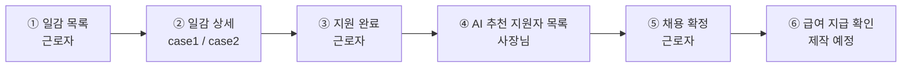

# PRD — 샵솔 스팟워크 AI 추천채용 — 처음 보는 지원자를 믿고 뽑게 하는 추천 기준 설계

Sep 24, 2026 · @Hyewon lee

## 0. 프로젝트 정의

**프로젝트명**: 샵솔 스팟워크 AI 추천채용 — 처음 보는 지원자를 믿고 뽑게 하는 추천 기준 설계 (PRD·포트폴리오 공통. 위솝 공식 서비스명은 아래 표)

이번 기획의 핵심(비중 95%)은 **스팟워크 AI 추천채용의 우선순위(가중치)와 추천이유 설계**다. 나머지 5%는 급여 지급 시점 킬러로직이다.

| 항목 | 내용 |
| --- | --- |
| 역할 | ALL ROLE: 이혜원 (스팟워크 AI 추천채용의 추천 가중치 기준 설계, UT, 화면 기획) |
| 기업명 | 위솝 |
| 서비스명 | 소상공인 채용난 해소를 위한 AI 기반 스팟워크 추천채용 및 HR 자동화 (샵솔 서비스 내 추가 기능) |
| 한 줄 소개 | 급하게 사람이 필요한 샵솔 매장 사장님에게, 샵솔 근태 데이터로 '안 빠지고 바로 일할 수 있는' 지원자를 순위와 추천이유 한 줄로 보여주는 기능 |
| 타겟 | 갑작스러운 인력 공백을 겪는 소상공인 매장 사장님 |
| 장기목표 | 샵솔 근태 데이터가 '누구를 믿고 뽑을지'의 기준이 되어, 매장이 급할 때 검증된 사람을 바로 뽑을 수 있게 한다 |
| 핵심질문 | 사장님은 처음 보는 지원자 중 누구를 먼저 믿고 뽑을까? 그 순서를 순위와 추천이유 한 줄로 보여주면 바로 채용을 결정할 수 있을까? |

| 비중 | 영역 | 이 문서의 위치 |
| --- | --- | --- |
| 95% | AI 추천 우선순위(0번 규칙 + 22개 항목 가중치) · 추천이유 한 줄 | 5장, 7-1장 |
| 5% | 킬러로직: 매장 선결제 후 당일지급, 어려우면 급여지급예정일 일자 명시 | 6장, 7-2장 |

## 1. 개요

샵솔 스팟워크에 AI 추천채용을 붙여, 사장님이 처음 보는 지원자 중 **안 빠지고 바로 일할 수 있는 사람**을 순위와 추천이유 한 줄로 고르게 한다. 여기에 급여 지급 시점 정책(킬러로직)을 더해 근로자가 안심하고 지원하게 한다.

| 항목 | 내용 |
| --- | --- |
| 타겟 | 갑작스러운 인력 공백을 겪는 소상공인 매장 사장님 (F&B부터 검증) |
| 문제 | 사장님이 처음 보는 지원자를 믿고 뽑을 근거가 없다 |
| 핵심 가설 | 사장님은 결격 사유(무단결근·취소)부터 거르고, 그다음 바로 투입 가능한 사람을 고른다 |
| 차별점 | 샵솔은 근로자가 **몇 시에, 어느 매장에서 퇴근하는지** 안다 → 퇴근 후 N잡 연결 + 무단결근 사전 차단 |
| 근거 | 작성자 스팟워크 544건 경험 · 사장님 UT 4회 · 근로자 UT 18명 |
| 공개 범위 | AI 추천채용 + 급여 지급 시점 정책만. 위솝 6대 개발목표(NDA)는 언급 금지 |

### UT 근거

| 대상 | 규모 | 검증한 것 | 결과 | 반영한 결정 |
| --- | --- | --- | --- | --- |
| 사장님 (소상공인 매장) | 4회 | 블라인드 지원자 4명 카드(점수 비노출)로 "누구를 뽑으시겠어요?" | 4명 전원 취소·무단결근 1건이면 추천서가 많아도 배제. 처음 보는 사람은 추천서 중시. 4회차에서 과거 근무자 실명으로 동일 매장 경험자 선호 | 0번 규칙(최하단 고정), 0순위 40점 > 1순위 28점, 동일 매장 최고 배점, 점수 대신 순위 + 추천이유 |
| 근로자 (일감 기반 근무 경험자) | 18명 | 어떤 일감에 지원하고 싶은가 | 근무종료시간 명확 제시, 근무 후 빠른 급여 지급에 지원 의사 높음. 3명이 일감 종류 확대 요청 | 킬러로직(선결제 당일지급 / 지급일 명시), 업종 확장 구조 |

UT는 스프린트 1\~3에 걸쳐 진행했다. 시기별 흐름(타겟 피벗)은 포트폴리오 회고에 정리한다.

상세 배점·구간표·결정 규칙은 설계 문서 `AI추천채용_매칭설계_최종본_09241455.docx`가 기준이다.

## 2. 목표와 성공 지표

목표는 세 가지다. 지표 목표치는 운영 데이터 확보 후 확정한다.

| 목표 | 성공 지표 | 측정 |
| --- | --- | --- |
| 무단결근·부당취소 감소 | 추천 1순위 채용자의 무단결근율 | 확정 근무 대비 무단결근 건수 |
| 빠른 매칭 | 공고 등록 → 채용 확정 소요시간, 사장님의 추천 1–3순위 채용 비율 | 공고·채용 확정 시각 |
| 급여 제때 지급 | "급여 제때 받으셨나요?" → "받았어요" 비율, 공고 등록 제한 매장 수 | 근로자 응답 |

보조 지표: 샵솔 근무와 겹치는 지원 경고 후 지원 철회율, 퇴근 후 N잡 매칭 건수.

## 3. 범위

이번 릴리스는 추천 기준과 급여 지급 시점 정책의 **로직·화면 시연**까지다. 풀 구현은 위솝 개발 단계에서 한다.

| 포함 | 제외 |
| --- | --- |
| 0번 규칙 + 22개 항목 100점 스코어링, 결정 규칙 28개 | 위솝 6대 개발목표(NDA) |
| 샵솔 근무 스케줄 연동(도착 여유, 근무시간 겹침) | F&B 외 업종 동심원 정의 (확장 단계) |
| 사장님 AI 추천 지원자 목록(순위 + 추천이유 한 줄) | 근무취소 확인 팝업, 근로자 안내 문구 화면 |
| 급여 지급 시점 정책: 입구·응답·출구 | 실제 급여 이체·정산 기능 |
| 시연 화면 6종(근로자 5 · 사장님 1) + 급여 지급 확인 화면(제작 예정) | 프로필 사진·성별·나이를 쓰는 모든 기능 |

## 4. 사용자 플로우

근로자가 일감을 고르고, 사장님이 AI 추천으로 채용하고, 근무 후 급여 지급을 확인하는 6단계다.

| 단계 | 화면 | 핵심 요구사항 |
| --- | --- | --- |
| ① | 이번 주 일감 목록 | 1주 요일순, 샵솔 근무일 표시, 퇴근 후 도보 시간·여유, 근무시간 겹침 경고, 지급 시점 배지 |
| ② | 일감 상세 | 지도(매장 · 샵솔 근무매장 · 도보 시간), 급여지급예정일 case1/case2 표기 |
| ③ | 지원 완료 | 근무확정은 근무시작 1시간 전까지, 확정 후 취소 불가 안내 |
| ④ | AI 추천 지원자 목록 | 점수 비노출, 순위 + 추천이유 한 줄 + 근무 매장명, 0번 규칙 해당자 최하단 "확인필요" |
| ⑤ | 채용 확정 | 시작 시각·도보 시간 안내 |
| ⑥ | 급여 지급 확인 | "급여 제때 받으셨나요?" 받았어요 / 못 받았어요 (6장) |

## 5. 기능 요구사항 — AI 추천 우선순위·추천이유 (핵심 · 비중 95%)

추천은 0번 규칙으로 결격자를 먼저 내리고, 22개 항목 100점으로 나머지 순위를 정한다. 같은 데이터면 누가 채점해도 같은 결과가 나오도록 결정 규칙 28개를 따른다.

### 5-1. 우선순위 구조

사장님이 채용을 결정하는 순서(UT 4회)를 그대로 배점 순서로 옮겼다.

| 순서 | 사장님의 질문 | 항목 | 배점 |
| --- | --- | --- | --- |
| 0번 규칙 | 결격 사유가 있는가 | 최근 12개월 무단결근·부당취소, 샵솔 근무시간 겹침 | 점수 무관 최하단 |
| 0순위 | 안 빠지는 사람인가 | 7개 | 40점 |
| 1순위 | 이 매장을 알아서 교육 없이 바로 일할 수 있는가 | 5개 | 28점 |
| 2순위 | 빨리 반응하고 시작 전에 도착할 수 있는가 | 4개 | 22점 |
| 3순위 | 접근성 (서비스 설계값, 전원 8.5점) | 6개 | 10점 |

### 5-2. 추천이유 한 줄 (먼저 맞는 하나)

| 순서 | 조건 | 문구 | 예시 (스시미찌 9/30) |
| --- | --- | --- | --- |
| ① | 0번 규칙 결격 | 근무취소 이력이 N건 있어요 (무단결근이면 "무단결근 이력이 N건 있어요") | 최다은: 근무취소 이력이 1건 있어요 |
| ② | 근무시간 겹침 | 샵솔 근무시간과 겹쳐요 | — |
| ③ | 동심원 | 우리 매장에서 N번 근무했어요 / 같은 브랜드(계열·업종) 매장에서 정규직으로 근무 중이에요 / …에서 근무 경험이 있어요 | 김민준: 우리 매장에서 3번 근무했어요 · 추천서 2건 |
| ④ | 동심원 없음 | 퇴근 후 N분이면 도착할 수 있어요 | — |
| ⑤ | 그 외 | 무단결근 없이 N회 근무했어요 | — |

추천서가 있으면 끝에 " · 추천서 N건"을 붙인다. 예시 순위: 김민준 86.20 → 이서연 70.70 → 박지호 52.80 → 최다은 80.20(최하단 고정), 점수는 화면에 노출하지 않는다.

### 5-3. 기능 요구사항 목록

**FR-0 공고 등록 규칙 — 근무 시작·종료 시각 필수 (핵심 기준)**

- 사장님은 공고 등록 시 근무 시작 시각과 **종료 시각**을 반드시 입력한다. 둘 중 하나라도 없으면 등록 버튼 비활성화
- "마감 시까지", "상황 봐서", "협의" 등 종료 시각이 특정되지 않는 표현 불가
- 이유: ① 0번 규칙 "근무시간 겹침"과 2순위 "시작 전 도착 가능성"은 시작·종료 시각이 있어야 계산된다 ② case1 "근무종료 1시간 후 지급"의 기준점이 종료 시각이다 ③ 근로자 UT 18명에서 근무종료시간이 명확한 일감에 지원 의사가 높았다
- 화면: 일감 목록·상세에 "18:00\~22:00(4시간)"처럼 시작\~종료와 시간을 항상 표시

**추천의 전제 — 사람이 잘 구해지는 공고 조건**

추천은 지원자가 모여야 작동한다. 아래 세 가지는 지원자 점수에 넣지 않고, 공고 쪽에서 지원자 풀을 늘리는 조건으로 둔다.

| 조건 | 왜 필요한가 | 처리 |
| --- | --- | --- |
| 근무 종료 시각 명시 | 근로자가 자기 시간과 비교해야 지원한다 | FR-0 필수 입력 |
| 급여 수준 | 시간 기반 급여가 충분해야 지원자가 모인다 | 시급·총액을 목록·상세에 표시. 금액은 사장님이 정하고 추천 점수에는 쓰지 않음(규칙 28) |
| 급여 지급 시점 | 제때 받는다는 믿음이 있어야 재방문한다 | 6장 킬러로직 |

급여를 추천 점수에 넣지 않는 이유: 추천 점수는 같은 공고에 지원한 사람끼리 비교하므로 급여가 모두 같다. 급여는 지원자를 모으는 데 작용하고, 순위를 가르는 데는 작용하지 않는다.

| ID | 요구사항 | 상세 |
| --- | --- | --- |
| FR-1 | 0번 규칙 ① 결격 | 최근 12개월 무단결근·부당취소 1건 이상 → 총점 무관 최하단 (부고장·당일 진료확인서 월 1회 예외) |
| FR-2 | 0번 규칙 ② 근무시간 겹침 | 샵솔 근무와 1분이라도 겹치면 지원 시 경고, 사장님 목록 최하단 |
| FR-3 | 0순위 무단결근방지 40점 | 7개 항목 (무결근 완료율 18점 등) |
| FR-4 | 1순위 신뢰성 28점 | 동심원(매장→브랜드→계열→업종) 누적 합산 + 매장 자발적 추천 |
| FR-5 | 2순위 즉시성 22점 | 알림 후 반응 속도 8 · 시작 전 도착 가능성 8 · 긴급공고 수락 3 · 직전 배정 수락 3 |
| FR-6 | 3순위 접근성 10점 | 서비스 설계값, 전원 동일 8.5점 |
| FR-7 | 도착 가능성 출발점 | ① 시작 전 3시간 안에 끝나는 샵솔 근무 매장 ② 지원 시각 GPS ③ 등록 주소. 이동시간 = 도보·대중교통 중 짧은 쪽 |
| FR-8 | 정렬 | 정상 그룹 총점 내림차순 → 플래그 그룹. 동점은 0순위 → 1순위 소계 → 지원 시각 |
| FR-9 | 추천이유 한 줄 | 먼저 맞는 하나: 근무취소 이력 → 겹침 → 동심원 → 퇴근 후 도착 → 무결근 횟수. 추천서 있으면 " · 추천서 N건" |
| FR-10 | 점수 비노출 | 사장님 화면에는 순위와 추천이유만 표시 |

항목별 구간표와 결정 규칙 28개 전문은 설계 문서 Ⅲ장·Ⅺ-1에 있다.

## 6. 급여 지급 시점 정책 (킬러로직 · 비중 5%)

모든 공고는 급여를 **case1 매장 선결제(카드결제) 후 근무종료 1시간 후 지급**하거나, 선결제가 어려우면 **case2 급여지급예정일을 반드시 일자로 명시**한다(근무일로부터 2주 이내). 공고에 적은 시점이 "제때"의 기준이 된다.

### 6-1. 입구 — 공고 등록 시 지급 시점 필수 선택

| 구분 | 사장님 입력 | 근로자 화면 표기 | "제때"의 기준 |
| --- | --- | --- | --- |
| case1 선결제 당일지급 (기본) | 공고 등록 시 급여를 카드로 선결제 | 급여지급예정일: "근무종료 후 1시간 후 급여지급 일감" + "매장이 급여를 미리 결제했어요" | 근무종료 + 1시간 |
| case2 지급일 명시 (선결제가 어려울 때) | 달력에서 지급일 지정 (근무일 \~ 근무일+14일만 선택 가능) | 급여지급예정일: "2026.10.07(수) 지급" + "근무일로부터 2주 이내" 정책 안내 | 지정한 날짜 |

- 지급 방식(case1/case2)과 근무 시작·종료 시각(FR-0) 중 하나라도 비어 있으면 공고 등록 버튼 비활성화
- "추후 협의", "월말 정산" 등 날짜가 특정되지 않는 표현 불가
- case2의 2주 상한: 근무일을 0일로 보고 14일째 날까지 (예: 9/30 근무 → 10/14까지)
- case1의 "근무종료 1시간 후"는 공고에 입력한 종료 시각이 기준
- case1은 선결제로 지급이 보장되므로 지연 위험이 거의 없고, 6-2 응답·6-3 출구는 주로 case2를 걸러낸다
- 선택한 시점은 일감 목록 배지와 일감 상세에 표시
- 실제 카드결제·정산 기능 구현은 위솝 개발 범위 (이번 기획은 정책·화면까지)

### 6-2. 응답 — 제때 지급 확인

| 공고 방식 | "급여 제때 받으셨나요?" 알림 시점 |
| --- | --- |
| case1 | 근무종료 1시간 후 이후, 근무 당일 |
| case2 | 지정한 지급일 다음 날 |

- 응답: 받았어요 / 못 받았어요. 근무 1건당 1회, 완료 기록 있는 근로자만
- 늦게 받으면 "받았어요"로 수정 가능 → 집계 제외. 무응답도 집계 제외
- 매칭 가중치의 "신규 필드 요구 안 함" 원칙의 유일한 예외(킬러로직 한정 신규 입력)

### 6-3. 출구 — 공고 등록 제한 (최근 3개월, OR 조건)

| 조건 | 기준 | 잡아내는 매장 |
| --- | --- | --- |
| ① 반복 지연 | 같은 근로자가 그 매장 2회차 이상 근무에서 "못 받았어요" 4회 이상 | 단골에게 반복적으로 늦게 주는 매장 |
| ② 다수 지연 | 서로 다른 근로자 5명이 "못 받았어요" | 누구에게나 늦게 주는 매장 |

- 3개월은 사장님이 공고 등록을 시도한 시각부터 거슬러 센다
- 해제: 미지급분 이체 증빙 + 근로자 "받았어요" 수정 시 즉시, 또는 3개월이 지나 기준 아래로 내려가면 자동
- 근거: 분위기가 좋아 재방문하지만 2회차부터 급여가 늦는 패턴(544건 경험), 근로자 UT 18명의 빠른 지급 선호

## 7. 화면 요구사항

일감 상세는 지도 하나로 **일할 매장 · 샵솔 근무 중인 매장 · 도보 시간**을 모두 보여주고, 급여지급예정일을 case1/case2로 나눠 표기한다.

### 7-1. 일감 상세 — 지도

| 요소 | 표시 | 데이터 |
| --- | --- | --- |
| ① 일할 매장 | 파란 핀 + "일할 매장 · 매장명" 라벨 | 대상일감\_매장위치 |
| ② 샵솔 근무 중인 매장 | 진한 청록 점 + "샵솔 근무 중인 매장" 라벨, 범례에 퇴근 시각 | 샵솔\_근무스케줄, 샵솔\_매장위치 |
| ③ 도보 시간 | ②→① 점선 경로 + "도보 N분" 칩, 범례에 시작 전 여유 | 지도 도보·대중교통 중 짧은 쪽 |

- 실제 서비스 지도는 위솝이 GPS 기반으로 얹는다. 시연 화면은 매장 주변 지도 캡처 위에 ①②③를 그렸다
- 샵솔 근무가 없는 날은 ② 대신 지원 시각 GPS → 등록 주소 순으로 출발점을 바꾼다 (FR-7)

### 7-2. 일감 상세 — 급여지급예정일

| 케이스 | 큰 글씨 | 정책 안내 (i) |
| --- | --- | --- |
| case1 선결제 당일지급 | 근무종료 후 1시간 후 급여지급 일감 (+ "매장 선결제 완료 · 오늘 23:00까지 지급") | 매장이 급여를 카드로 미리 결제했어요. 근무종료 후 1시간 이내에 지급돼요. |
| case2 지급일 명시 | 2026.10.07(수) 지급 | 지급일을 명시한 일감은 근무일로부터 2주 이내로만 지급일을 정할 수 있어요. (이 일감은 10/14까지) |

### 7-3. KRDS 반영 원칙

브랜드 색(진한 청록)과 화면 구성은 유지하고, [KRDS 타이포그래피](https://www.krds.go.kr/html/site/style/style_03.html)·[색상](https://www.krds.go.kr/html/site/style/style_02.html) 기준을 따른다.

| 항목 | KRDS 기준 | 적용 |
| --- | --- | --- |
| 서체 | Pretendard GOV | 시연 화면 전체 적용 |
| 본문 크기 | Body medium 17px | 상세 정보 행 17px, 보조 문구 15px |
| 줄간격 | 150% 이상 | 1.5 |
| 굵기 | Regular 400 / Bold 700 | 두 가지만 사용 |
| 명도 대비 | 일반 텍스트 4.5:1 이상(AA) | 본문 #1E2124, 보조 #4F5857, 브랜드 #1F4648 on 흰 배경 |
| 터치 영역 | (WCAG 2.5.5) 44px 이상 | 뒤로가기 44px, 지원 버튼 56px |

- 시연 화면 6종(일감 목록 · 일감 상세 case1/case2 · 지원 완료 · AI 추천 지원자 목록 · 채용 확정) 모두 Pretendard GOV, 굵기 400/700, 주요 텍스트 17px · 보조 15px · 라벨 13\~14px로 통일
- 시연 매장명은 지점명 없이 "스시미찌"로 통일 (지도는 길동역 주변, 일감 목록 지역 필터는 "길동")

## 8. 데이터·개인정보·규제

추천 점수는 기존 샵솔 근태·위솝 플랫폼 데이터만 쓴다. 새로 더해지는 입력은 두 가지다: 근로자의 "급여 제때 받으셨나요?" 응답, 사장님의 공고 등록 시 지급 방식(case1 선결제 / case2 지급일) 선택.

| 구분 | 요구사항 |
| --- | --- |
| 스케줄·위치 활용 | 근로자의 "근태 데이터 매칭 활용 동의" 전제. 지원 시각 GPS는 이동시간 계산에만 쓰고 저장하지 않음 |
| 점수 미사용 속성 | 성별·나이·프로필 사진은 매칭 엔진에 전달하지 않음. 사장님 화면에 "성별·나이·사진은 매칭 점수에 반영하지 않아요" 표시 |
| 규제 근거 | 미국 NYC Local Law 144(AEDT), 채용절차법 제4조의3, 국가인권위원회법 제2조 제3호 |
| 부당취소 판단 | 근무취소\_사유코드·증빙제출여부 필요. 없으면 확정 후 근로자 취소를 전부 부당취소로 간주 |
| 급여 응답 | 근무 1건당 1회, 완료 기록 있는 근로자만. 응답자 신원은 사장님에게 노출하지 않음 |
| 근무금액 | 점수 미사용, 화면 표시용 |

컬럼 전체 정의는 설계 문서 Ⅴ장에 있다.

## 9. 오픈 이슈·위솝 확인 요청·일정

발표(9/30) 전에 막는 이슈는 없고, 아래는 위솝 개발 단계에서 확정한다.

**위솝 확인 요청**

- [ ] 근무취소 사유코드·증빙 데이터가 샵솔에 있는지
- [ ] 샵솔 근무표 확정 주기 (주 단위인지) — 일감 목록 1주 범위의 근거
- [ ] 스케줄·위치를 매칭에 활용하는 동의 절차
- [ ] 실제 지도 GPS 연동 방식 (샵솔 근무매장 → 일할 매장 경로 표시)

**오픈 이슈**

- [ ] "근무취소 이력"과 "근무시간 겹침"이 둘 다 최하단일 때 순서 (추천: 결격을 맨 아래)
- [ ] 구간 커트라인·지표 목표치는 운영 데이터 확보 후 재검증

**일정**

| 날짜 | 할 일 |
| --- | --- |
| 9/25\~27 | 급여 지급 확인 화면(⑥) 포함 킬러로직 화면 3종, 포트폴리오 수정 |
| 9/28\~29 | 발표자료 제작·예행연습 |
| 9/30 | 최종발표 |
