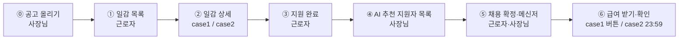

# PRD — 샵솔 스팟워크 AI 추천채용 — 처음 보는 지원자를 믿고 뽑게 하는 추천 기준 설계

Sep 26, 2026 · TeamK Hyewon Lee · **9/26 최종** (9/25 결정 13건과 이유 · 근무확정 후 취소 = 무단결근 · 결격 기간 무관 · 킬러컨텐츠/킬러로직 · 지원자 팝업 2종 · 예외 케이스 15건·젬스 검증 · Phase 2 반영)

**30초 요약 — 처음 보는 사람을 위한 한 장**

- **무엇을**: 사장님이 급하게 사람을 구할 때, 지원자 중 **누구를 먼저 보여 줄지** AI가 순서를 매겨 줍니다.
- **맨 아래로**: 한 번이라도 **무단결근**하거나 **확정된 근무를 취소**한 사람은 점수와 상관없이 맨 아래에 둡니다. 사장님 4명 모두 "1건이라도 있으면 안 뽑는다"고 했기 때문입니다.
- **나머지는 네 가지 점수(100점)**: 무단결근방지 40(안 빠지는 사람인가) · 신뢰성 28(이 매장 일을 바로 할 수 있는가) · 즉시성 22(얼마나 빠르게 매칭되는가) · 접근성 10(얼마나 손쉽게 구인구직이 가능한가, 모두 같은 점수)
- **사장님 화면**: 점수 대신 "우리 매장에서 3번 근무했어요" 같은 **이유 한 줄**만 보입니다.
- **위솝이라서 가능한 것**: 샵솔 근태 기록(누가 안 빠지는지) · 근무표(언제 어디서 퇴근하는지) · 매장을 가맹본사 단위로 묶어 보는 구조(동심원). 급구·당근처럼 매장마다 따로 가입하는 서비스는 못 합니다.
- **급여 약속**: 사장님이 급여를 미리 결제하거나 지급일을 정해야만 공고를 올릴 수 있습니다.
- **AI가 늘 같은 답을 내나**: 규칙을 빈칸 없이 정한 뒤 까다로운 사례 15명을 Gemini에 3번 넣었더니 45번 모두 같은 결과가 나왔습니다.

## 0. 프로젝트 정의

**프로젝트명**: 샵솔 스팟워크 AI 추천채용 — 처음 보는 지원자를 믿고 뽑게 하는 추천 기준 설계 (PRD·포트폴리오 공통. 위솝 공식 서비스명은 아래 표)

이번 기획의 핵심(비중 95%)은 **스팟워크 AI 추천채용의 우선순위(가중치)와 추천이유 설계**다. 나머지 5%는 급여 지급 시점 킬러컨텐츠(선결제 또는 지급일자를 확정해야 공고를 올릴 수 있음)와 이를 뒷받침하는 킬러로직이다.

| 항목 | 내용 |
| --- | --- |
| 역할 | ALL ROLE: 이혜원 (스팟워크 AI 추천채용의 추천 가중치 기준 설계, UT, 화면 기획) |
| 기업명 | 위솝 |
| 서비스명 | 소상공인 채용난 해소를 위한 AI 기반 스팟워크 추천채용 및 HR 자동화 (샵솔 서비스 내 추가 기능) |
| 한 줄 소개 | 급하게 사람이 필요한 샵솔 매장 사장님에게, 샵솔 근태 데이터로 '안 빠지고 바로 일할 수 있는' 지원자를 우선순위와 추천이유 한 줄로 보여주는 기능 |
| 타겟 | 갑작스러운 인력 공백을 겪는 소상공인 매장 사장님 |
| 장기목표 | 샵솔 근태 데이터가 '누구를 믿고 뽑을지'의 기준이 되어, 매장이 급할 때 검증된 사람을 바로 뽑을 수 있게 한다 |
| 핵심질문 | 사장님은 처음 보는 지원자 중 누구를 먼저 믿고 뽑을까? 그 순서를 순위와 추천이유 한 줄로 보여주면 바로 채용을 결정할 수 있을까? |

| 비중 | 영역 | 이 문서의 위치 |
| --- | --- | --- |
| 95% | AI 추천 우선순위(0번 규칙 + 21개 항목 가중치) · 추천이유 한 줄 | 5장, 7-1장 |
| 5% | 킬러컨텐츠: 선결제(근무종료 1시간 후 급여지급) 또는 지급일자를 확정해야 공고 등록 / 킬러로직: 지급 확인 → 약속 미이행 집계 → 공고 등록 제한 | 6장, 7-2장 |

## 1. 개요

샵솔 스팟워크에 AI 추천채용을 붙여, 사장님이 처음 보는 지원자 중 **안 빠지고 바로 일할 수 있는 사람**을 순위와 추천이유 한 줄로 고르게 한다. 여기에 급여 지급 시점 킬러컨텐츠와 이를 뒷받침하는 킬러로직을 더해 근로자가 안심하고 지원하게 한다.

| 항목 | 내용 |
| --- | --- |
| 타겟 | 갑작스러운 인력 공백을 겪는 소상공인 매장 사장님 (F&B부터 검증) |
| 문제 | 사장님이 처음 보는 지원자를 믿고 뽑을 근거가 없다 |
| 핵심 가설 | 사장님은 결격 사유(무단결근·취소)부터 거르고, 그다음 바로 투입 가능한 사람을 고른다 |
| 차별점 | 샵솔은 근로자가 **몇 시에, 어느 매장에서 퇴근하는지** 안다 → 퇴근 후 N잡 연결 + 무단결근 사전 차단 |
| 근거 | 작성자 급구 848번 근무 경험(추천서 81건 · 근무취소 0 · 결근 0) · 사장님 UT 4회 · 근로자 UT 18명 |
| 공개 범위 | AI 추천채용 + 급여 지급 시점 정책만. 위솝 6대 개발목표(NDA)는 언급 금지 |

### UT 근거

| 대상 | 규모 | 검증한 것 | 결과 | 반영한 결정 |
| --- | --- | --- | --- | --- |
| 사장님 (소상공인 매장) | 4회 | 블라인드 지원자 4명 카드(점수 비노출)로 "누구를 뽑으시겠어요?" | 4명 전원 취소·무단결근 1건이면 추천서가 많아도 배제. 처음 보는 사람은 추천서 중시. 동일 매장 근무자로 제시된 사례를 선호하며 재고용 희망 | 0번 규칙(최하단 고정), 0순위 40점 > 1순위 28점, 동일 매장 최고 배점, 점수 대신 순위 + 추천이유 |
| 근로자 (일감 기반 근무 경험자) | 18명 | 어떤 일감에 지원하고 싶은가 | 근무종료시간 명확 제시, 근무 후 빠른 급여 지급에 지원 의사 높음. 3명이 재택형 IT N잡(게임테스터·멘토링) 요청 | 킬러컨텐츠(선결제 당일지급 / 지급일 명시)·킬러로직, N잡 확장(일감 목록 IT/게임·멘토링, 3장)·업종 확장 구조 |

UT는 스프린트 1\~3에 걸쳐 진행했다. 시기별 흐름(타겟 피벗)은 포트폴리오 회고에 정리한다.

상세 배점·구간표·결정 규칙은 설계 문서 `AI추천채용_매칭설계_최종본_20260927.docx`가 기준이다. 9/25 결정 13건과 이유는 프로젝트 `0925_결정규칙_최종.md`, 채점 절차·예외 케이스·젬스는 `위솝xTeamK_젬스검증패키지_0925.md`, 위솝 전달자료는 `위솝PM_전달검토자료_20260927.docx`에 있다.

## 2. 목표와 성공 지표

목표는 세 가지다. 지표 목표치는 운영 데이터 확보 후 확정한다.

| 목표 | 성공 지표 | 측정 |
| --- | --- | --- |
| 무단결근·확정 후 취소 감소 | 추천 1순위 채용자의 무단결근율 | 확정 근무 대비 무단결근 건수 |
| 빠른 매칭 | 공고 등록 → 채용 확정 소요시간, 사장님의 추천 1–3순위 채용 비율 | 공고·채용 확정 시각 |
| 급여 제때 지급 | case2 지급예정일 약속 이행률("네" 응답 비율), 약속 미이행(미지급·지연) 건수, 공고 등록 제한 매장 수 | 근로자 응답 |

보조 지표: 샵솔 근무와 겹치는 지원 경고 후 지원 철회율, 퇴근 후 N잡 매칭 건수.

## 3. 범위

이번 릴리스는 추천 기준과 급여 지급 시점 정책의 **로직·화면 시연**까지다. 풀 구현은 위솝 개발 단계에서 한다.

| 포함 | 제외 |
| --- | --- |
| 0번 규칙 + 21개 항목 100점 스코어링, 결정 규칙 28개 | 위솝 6대 개발목표(NDA) |
| 샵솔 근무 스케줄 연동(도착 여유, 근무시간 겹침) | F&B 외 업종 동심원 정의 (확장 단계) |
| 사장님 AI 추천 지원자 목록(순위 + 추천이유 한 줄) | 증빙 첨부·심사 기능 구현 (근무취소 정책·팝업 화면은 9/25 범위에 포함) |
| 급여 지급 시점 정책: 입구·응답·출구 | 실제 급여 이체·정산 기능 |
| 공고 등록 규칙: 근무시간 10분 단위, 4시간마다 휴게 30분(유급/무급 선택), AI 추천(3시간 50분 / 4시간 30분) | 휴게 시간대(몇 시부터) 지정 |
| 시연 화면 16종(근로자 12 · 사장님 3 · 공통 1): 일감 목록 · 일감 상세 case1/case2 · **지원확인 팝업(+전체화면 변형)** · 지원 완료 · 채용 확정 · **근무취소 팝업** · 급여 받기 case1 대기/활성/이체 완료 · 급여 확인 case2/보완 + AI 추천 지원자 목록 · 공고 올리기 case1/case2 + 채용 후 메신저 | 프로필 사진·성별·나이를 쓰는 모든 기능 |

**Phase 2**: 근로자용 일감 추천 — 좋았던 매장 재방문 일감 우선 노출(근로자 매장 평가 필요), 공고 급여 수준 가이드(동네 평균 시급 대비 표시)

**Phase 2 추가 검토 (9/25)** — 근로자에게 어필하는 매장의 실질적인 근무 경험은 이번 범위에서 고려하지 않고 Phase 2에서 고민한다. 이번 범위의 근로자 쪽 요소는 킬러컨텐츠(급여 지급 약속), N잡 확장(아래, 새 입력 없이 공고 분류와 샵솔 스케줄만 사용), 공고 필수 조건(종료 시각·휴게·급여 표시)뿐이다

- **근무경험 공유**: 근무를 마친 근로자가 남긴 근무경험(키워드 중심 + 200자 이내)을, 다른 근로자가 지원할 때 그 매장 공고와 함께 볼 수 있는지. 근로자 평가는 신규 입력이라 "신규 필드 요구 안 함" 원칙에 따라 이번 범위에서 뺀다. 지금은 재방문(동일 매장 재근무) 행동으로만 반영
- **식사 제공 여부**: 사장님이 공고에 식사 제공 여부를 적는 항목
- **복장 코드**: 일감에 올 때의 복장을 사장님이 공고에 적는 항목
- 세 가지 모두 추천 점수에는 쓰지 않는 공고·지원 화면 정보로 검토한다 (추천의 전제와 같은 성격)

**N잡 확장 — 근로자 UT 의견 반영 (지원자 풀을 늘리는 공급 쪽 장치) (9/26)** 이번 가중치는 사업주를 위한 것이지만, **근로자가 쓰고 싶어야 사업주에게 추천할 지원자도 생긴다.** 그래서 근로자 쪽에는 두 장치만 둔다: 급여 약속(킬러컨텐츠)과 N잡 확장. 근로자 UT 18명 중 3명이 재택형 IT N잡을 원했고, 게임테스터와 멘토링을 직접 예로 들었다. 실제 의견: "F&B 스팟워크 일감만 있으면 알바몬이 아니라 왜 이 앱을 써야 하는지 모르겠다". **샵솔이 새로 끌어올 수 있는 스팟워크 예비 근로자**의 목소리이고, 이들이 **다른 스팟워크 앱이 아니라 샵솔을 쓸 이유**가 된다. 그래서 일감 목록에 반영했다. 목적은 N잡러가 샵솔 채용 기능에 더 반응하게 해서, 사장님 추천(95%)이 작동할 지원자가 모이게 하는 것이다. "추천의 전제"(종료 시각·휴게·급여 표시)와 같은 성격의 공급 쪽 장치다.

| 구분 | 내용 |
| --- | --- |
| 무엇을 | 일감 목록의 카테고리 칩(전체 · 1시간 내 지급 · 외식/식음료 · IT/게임 · 멘토링)과 윈드롬 게임테스터(재택, 10/4(일) 19:00\~22:00) "N잡 확장" 카드. UT 참가자가 직접 든 예시(게임테스터·멘토링)를 그대로 반영했다 |
| 다른 스팟워크 앱과의 차이 | 급구·당근 같은 앱도 업종별 일감은 보여준다. 하지만 근로자가 **본업 근무를 언제 어디서 하는지 모른다**. 샵솔은 본업 근무 스케줄과 매장 위치를 알기 때문에, 업종이 달라도 본업과 겹치는 일감은 미리 알려 주고, 겹치지 않는 빈 시간의 N잡을 보여 줄 수 있다. 다양한 N잡을 **샵솔 안에서** 보여줘야 하는 이유 |
| 왜 샵솔이어야 하는가 | 업종이 달라도 샵솔 근무 시간표를 기준으로 **근무시간 겹침 경고와 빈 시간 표시가 똑같이 작동**한다. F&B 매장에서 일하는 사람이 샵솔 근무가 없는 저녁·주말에 재택 게임테스트나 멘토링을 겹치지 않게 잡을 수 있다 |
| 킬러컨텐츠도 업종 무관 | 게임테스터 카드의 "급여 10/8(목) 지급 확정"처럼, 선결제 또는 지급일 확정이 공고 등록 조건인 규칙은 모든 업종에 똑같이 적용된다 |
| 이번 범위의 선 ① | **추천이 아니다.** 일감 목록은 날짜순이고 샵솔 스케줄 정보(겹침·퇴근 후 여유)만 표시한다. 근로자용 일감 추천은 Phase 2 |
| 이번 범위의 선 ② | **새 입력이 없다.** 기존 공고 분류와 샵솔 스케줄만 쓴다. 근무후기·식사·복장처럼 근로자에게 매장을 어필하는 정보(Phase 2)와 구분된다 |
| 이번 범위의 선 ③ | **검증은 F&B.** 다른 업종 공고의 지원자 채점에도 0번 규칙·0순위·2순위 반응 속도·긴급·직전·3순위는 그대로 적용된다. 업종에 따라 다시 정의할 것은 1순위 동심원 단계(예: IT/게임 = 같은 의뢰처 → 같은 회사 → 같은 장르)와 재택 일감의 도착 가능성(목적지 정의) 두 가지이고, 확장 단계(Phase 2)에서 정한다 |

발표 문장: "추천 기준은 사장님을 위한 것이지만, 근로자가 쓰고 싶어야 추천할 사람도 생깁니다. 근로자 UT 18명 중 3명, 샵솔이 새로 끌어올 수 있는 예비 근로자들이 재택형 IT N잡을 원했고, 게임테스터와 멘토링을 직접 예로 들었습니다. 한 분은 "F&B 스팟워크 일감만 있으면 알바몬이 아니라 왜 이 앱을 써야 하는지 모르겠다"고 하셨습니다. 이게 다른 앱이 아니라 샵솔을 쓸 이유가 됩니다. 급구나 당근 같은 앱도 여러 업종 일감을 보여주지만, 근로자가 본업을 언제 어디서 하는지는 모릅니다. 샵솔은 알기 때문에, 업종이 달라도 본업과 겹치는 일감은 미리 알려 주고, 빈 시간의 N잡을 보여 주며, 지급일 약속도 그대로 지킵니다. 검증은 F&B에서 했고, 다른 업종은 동심원 단계만 바꾸면 같은 구조로 확장됩니다." 이 일감 목록 화면은 최종 시연 화면으로 그대로 쓴다.

**일감 목록 화면 요소 ↔ 근거 (9/26)**

| 화면 요소 | 근거 |
| --- | --- |
| 이번 주(9/30\~10/6) · 날짜순 묶음 | 샵솔 근무표가 보통 주 단위라 1주 범위. 추천 순위가 아니라 날짜순 목록 (근로자용 일감 추천은 Phase 2) |
| 날짜 칸 초록 막대 · "샵솔 근무일 · 근무시간과 겹치는 일감은 미리 알려드려요" | 샵솔 근무일 표시. 0번 규칙 ② 근무시간 겹침(FR-2)을 근로자에게 먼저 알림 |
| 필터 "샵솔 근무매장 10km" | 샵솔 근무매장 기준 거리. 퇴근 후 N잡 연결(샵솔 강점) |
| 칩 "1시간 내 지급" | 킬러컨텐츠 case1 (선결제 → 근무종료 1시간 후 급여지급) |
| 칩 "IT/게임 · 멘토링" | N잡 확장. 근로자 UT 18명 중 3명이 재택형 IT N잡을 원했고 게임테스터·멘토링을 직접 예로 들었음 |
| 스시미찌 "근무매장 퇴근 후 도보 12분 · 여유 48분" | 2순위 도착 가능성, 출발점 ① 샵솔 근무매장 퇴근(17:00) |
| 고양꼬치 "4시간 30분 · 무급 휴게 30분" | FR-0-1 휴게시간 규칙 (4시간마다 30분, 유급/무급 사장님 선택) |
| 고드니 "샵솔 근무(14:00\~19:00)와 겹쳐요" | 0번 규칙 ② 겹침. 숨기지 않고 경고만 표시해 근로자가 판단하게 함 |
| 윈드롬 게임테스터 "재택 · 급여 10/8(목) 지급 확정 · N잡 확장" | 킬러컨텐츠 case2(근무일로부터 2주 이내)가 업종과 상관없이 적용. 10/4(일)은 샵솔 근무가 없는 날이라 겹침 없음. 재택이라 도착 정보는 표시하지 않음(재택 도착 기준은 Phase 2) |

## 4. 사용자 플로우

사장님이 공고를 올리고, 근로자가 일감을 고르고, 사장님이 AI 추천으로 채용하고, 근무 후 급여 지급을 확인하는 7단계다.

| 단계 | 화면 | 핵심 요구사항 |
| --- | --- | --- |
| ⓪ | 공고 올리기 (사장님) | 근무시간 10분 단위·종료 시각 필수, 4시간마다 휴게 30분(유급/무급 선택), AI 추천(3시간 50분 / 4시간 30분), 지급 방식 case1/case2 (FR-0·FR-0-1, 7-4) |
| ① | 이번 주 일감 목록 | 1주 요일순, 샵솔 근무일 표시, 퇴근 후 도보 시간·여유, 근무시간 겹침 경고, 지급 시점 배지, 휴게 있으면 "휴게 30분 · 무급/유급" 칩 |
| ② | 일감 상세 | 지도(매장 · 샵솔 근무매장 · 도보 시간), 휴게시간 행, 급여지급예정일 case1/case2 표기 |
| ③ | 지원 완료 | 근무확정은 근무시작 1시간 전까지, 확정 후 취소 불가 안내 |
| ④ | AI 추천 지원자 목록 | 점수 비노출, 순위 + 추천이유 한 줄 + 근무 매장명, 0번 규칙 해당자 최하단 "확인필요" |
| ⑤ | 채용 확정 · 메신저 | 시작 시각·도보 시간 안내. 이어서 사장님–근로자 메신저(프로토타입에서 시연): "채용이 완료되었습니다" · "늦지 않게 꼭 도착해 주시기 바랍니다" · 채용된 일감(일자·시간·급여·위치) |
| ⑥ | 급여 받기·지급 확인 | case1: 근무종료 1시간 후 \[○○원 급여받기\] 버튼 활성 → 근로자가 눌러 받음 → 이체 완료 화면(입금자명 "샵솔\_매장명", 받을 계좌·예금주) / case2: 지급예정일 23:59 "급여를 받으셨나요?" 네·아니오 → 아니오면 나중에 받은 날짜 보완 (6장) |

## 5. 기능 요구사항 — AI 추천 우선순위·추천이유 (핵심 · 비중 95%)

추천은 0번 규칙으로 결격자를 먼저 내리고, 21개 항목 100점으로 나머지 순위를 정한다. 같은 데이터면 누가 채점해도 같은 결과가 나오도록 결정 규칙 28개를 따른다.

### 5-1. 우선순위 구조

사장님이 채용을 결정하는 순서(UT 4회)를 그대로 배점 순서로 옮겼다.

| 순서 | 사장님의 질문 | 항목 | 배점 |
| --- | --- | --- | --- |
| 0번 규칙 | 결격 사유가 있는가 | 무단결근·확정 후 취소(기간 무관, 스팟·정규), 샵솔 근무시간 겹침 | 점수 무관 최하단 |
| 0순위 | 안 빠지는 사람인가 | 6개 | 40점 |
| 1순위 | 이 매장을 알아서 교육 없이 바로 일할 수 있는가 | 5개 | 28점 |
| 2순위 | 얼마나 빠르게 매칭되는가 (빨리 반응하고 시작 전에 도착하는가) | 4개 | 22점 |
| 3순위 | 접근성 — 얼마나 손쉽게 구인구직이 가능한가? (서비스 설계값) | 6개 | 10점 |

**3순위 접근성 — 얼마나 손쉽게 구인구직이 가능한가?** (6개 · 10점)

| # | 항목 | 배점 | 채점 | 이유 |
| --- | --- | --- | --- | --- |
| 1 | 근무이력 자동 반영 (정규직·스팟워크 무관) | 3.0 | 자동 만점 | 샵솔에 쌓인 근무기록이 지원서에 자동으로 붙어, 지원자는 경력을 따로 적지 않고 사장님은 확인된 기록을 바로 본다. 구인·구직 양쪽의 수고를 가장 크게 줄여 가장 높게 |
| 2 | 가입\~첫 지원 평균 소요시간 | 2.0 | 운영 데이터 전까지 절반 1.0 | 가입하고 첫 지원까지 오래 걸리면 신규는 그 사이에 떠난다. 처음 들어오는 문턱이 얼마나 낮은지 본다 · 아직 데이터가 없어 절반만 |
| 3 | 지원 시 입력 단계 수 | 1.5 | 1단계=1.5 / 2단계=1.0 / 3단계+=0.5 (현재 1단계) | 급한 공고는 금방 마감돼서, 입력이 한 단계만 늘어도 지원을 놓친다 |
| 4 | 원클릭 재지원 | 1.5 | 있음=1.5 / 없음=0 | 일해 본 매장에 다시 지원할 때 처음부터 입력하지 않게 해서, 사장님이 반기는 '와 본 사람'이 다시 오기 쉽게 |
| 5 | 지원\~매장 응답 평균 대기시간 | 1.0 | 운영 데이터 전까지 절반 0.5 | 지원해 놓고 답을 못 받으면 구직자는 다른 일을 잡지 못한다 · 아직 데이터가 없어 절반만 |
| 6 | 지원현황 실시간 확인 | 1.0 | 있음=1.0 / 없음=0 | 됐는지 안 됐는지 바로 알아야 다음 일정을 잡는다 |
|  | 합계 | 10.0 | 합계 8.5 (모든 지원자 같은 점수) | 지원자가 아니라 서비스(샵솔)가 지켜야 할 목표라서 모두 같은 점수(3.0+1.0+1.5+1.5+0.5+1.0 = 8.5). 서비스가 좋아지면 모두 함께 올라간다(2·5번 운영 데이터가 확정되면 최대 10) |

왜 배점은 10점인데 모두 8.5점인가: 10점은 6개 기준을 모두 채웠을 때의 만점이에요. 지금은 가입\~첫 지원 시간(2.0)과 응답 대기시간(1.0)의 운영 데이터가 아직 없어 두 기준을 절반(1.0 · 0.5)만 줘서, 10점에서 1.5점이 빠진 8.5점이에요. 이 점수는 지원자 한 사람이 아니라 샵솔 서비스의 상태를 재는 거라 모든 지원자가 같은 8.5점을 받고, 그래서 순위에는 영향이 없어요. 운영 데이터가 쌓여 두 기준이 확정되면 모두 함께 최대 10점까지 올라가요.

**공통 매칭 구조 — 동심원 원리 (이번 기획의 핵심 구조)**

- **그림 읽는 법**: 왼쪽 동심원은 가운데로 갈수록 이 매장과 가까운 경험이라 점수가 높아요. 오른쪽은 샵솔 어느 매장에서든 안 빠진 기록이 한 사람의 기록으로 모여요
- **어디에 쓰이나**: 4가지 점수(무단결근방지 · 신뢰성 · 즉시성 · 접근성) 중 **0순위 무단결근방지와 1순위 신뢰성에만** 쓰여요. 2순위 즉시성 · 3순위 접근성에는 쓰지 않아요
- **오른쪽 그림 · 위솝 전체 플랫폼** → **0순위 무단결근방지(40점)에서만 반영** "안 빠지는 사람인가": 샵솔 어느 매장에서든 안 빠지고 끝낸 기록(완료율 · 완료 건수 · 상위비율 · 연속 근무일)
- **왼쪽 동심원 4단계(업종 · 계열 · 브랜드 · 매장)** → **1순위 신뢰성(28점)에서 반영** "이 매장 일을 바로 할 수 있는가": 해당 원부터 동일 업종까지 모두 더해요 (동일 매장 정규 = 11.0 + 4.5 + 3.5 + 2.5 = 21.5점, 단계마다 정규 경력 우선)
- **이 매장에서 1번이라도 일했다면** 무단결근방지에서도 3점을 더 받아요 (이 매장 근무 경험)
- 급구 · 당근알바처럼 매장마다 따로 가입하는 서비스는 이 구조를 만들 수 없어요. 위솝이 가맹본사 단위로 매장을 묶어 보기 때문에 가능한 구조예요

**신뢰성 산식과 예시** — 신뢰성 = 동심원 점수(가장 가까운 단계부터 업종까지 모두 더함, 최대 21.5) + 매장 추천(최대 6.5). 점수 두 개 중 앞 = 정규직, 뒤 = 스팟워크로 일한 경험이고, 24개월 안에 끝낸 근무가 1번이라도 있으면 받습니다(횟수 무관).

예시 — 이번 일감이 「스시이안앤 잠실」이라면: 동일 매장 = 스시이안앤 잠실 · 동일 브랜드 = 스시이안앤 건대(같은 브랜드의 다른 매장) · 동일 계열 = 보승회관 건대(스시이안앤과 같은 계열 · 본사의 다른 브랜드) · 동일 업종 = 미카도스시 건대(다른 회사의 스시 매장)

| 가장 가까운 경험 | 정규 | 스팟 |
|---|---|---|
| 이 매장 (스시이안앤 잠실) | 11.0 + 4.5 + 3.5 + 2.5 = 21.5 | 9.8 + 4.4 + 3.4 + 2.4 = 20.0 |
| 같은 브랜드 (스시이안앤 건대) | 4.5 + 3.5 + 2.5 = 10.5 | 4.4 + 3.4 + 2.4 = 10.2 |
| 같은 계열 (보승회관 건대) | 3.5 + 2.5 = 6.0 | 3.4 + 2.4 = 5.8 |
| 같은 업종만 (미카도스시 건대) | 2.5 | 2.4 |
| 같은 업종 경험 없음 | 0 | 0 |

- 미카도스시 건대처럼 다른 회사 스시 매장에서만 일해 봤다면 1-4 점수만 받고 1-1~1-3 점수는 받지 못합니다. 브랜드가 없는 개인 매장은 브랜드 · 계열 단계를 건너뜁니다(이 매장 스팟 = 9.8 + 2.4 = 12.2). 같은 단계에 정규 · 스팟이 둘 다 있으면 그 단계는 정규 점수입니다(이 매장 스팟 + 같은 브랜드 정규 = 9.8 + 4.5 + 3.5 + 2.5 = 20.3).
- 왜 이렇게 정했나(1-1~1-4 한꺼번에): ① 이 매장에서 단 1번이라도 안 빠지고 끝낸 건 매우 강력한 신호라서 1-1을 가장 크게 ② 매장 → 브랜드 → 계열 → 업종 순으로 멀어질수록 교육이 더 필요해 점수가 작아짐 ③ 가까운 경험은 바깥 단계도 함께 아는 것이라 누적 합산 ④ 정규는 연속 근무로 이해도 · 책임 · 계속 근무 가능성이 더 높아 단계마다 정규 우선

**항목별 배점 이유 (9/26 · 기획자가 직접 정함)** — 근거: 작성자 급구 848번 근무 경험(추천서 81건 · 근무취소 0 · 결근 0) · 사장님 UT 4회 · 근로자 UT 18명

| 항목 | 배점 | 이유 |
| --- | --- | --- |
| 카테고리 배점 40 · 28 · 22 · 10 | 100 | **사장님 판단의 무게**: 안 빠질 사람인지가 가장 무겁고(40), 교육 없이 바로 일할 수 있는지(28)가 그다음, 속도(22)는 앞 두 조건이 비슷할 때 가르는 보조 기준 / **아래가 위를 못 넘게**: 아래 카테고리 만점이 항상 바로 위 카테고리보다 작다(22 < 28 < 40) |
| 0번 규칙 (결격 · 겹침) | 점수 무관 최하단 | UT 4회 전원이 "단 1건이라도 있으면 안 뽑는다"고 답함(추천서 최다 지원자도 예외 없음). 확정 후 취소 = 무단결근(매장엔 둘 다 펑크). 무단결근 기록은 사라지지 않는다(결정 13) |
| 0-1 스팟워크 무결근 완료율 | 18.0 | 스팟워크의 가장 큰 위험이 무단결근이고, 안 빠지는지를 가장 직접 보여주는 기록이라 최고 배점. 결정 13 이후 정상 그룹에서는 \*\*검증된 경험자(18) 대 신규(9)\*\*를 가르고, 낮은 구간은 결격 그룹 안 순서를 정한다 |
| 0-2 정규직 무단결근 이력 | 6.0 | 스팟 완료 건수(8)보다 작은 이유: 1건이라도 있으면 0번 규칙으로 이미 맨 아래로 보내므로, 이 6점은 결격 그룹 안의 순서용이다 · 정규직은 출근 구조가 받쳐 주어 깨끗한 기록 자체는 변별력이 낮아, 무단결근 이력만 따로 반영. 정상 그룹은 전원 6점이고 결격 그룹 안 순서에 쓰인다 |
| 0-3 스팟워크 완료 건수 (전체 기간, 20건+=8 / 10\~19=6 / 5\~9=4 / 1\~4=2 / 0=0) | 8.0 | **정상 그룹 안의 변별력: 결격이 있으면 C로 가므로 정상 그룹의 완료율은 100% 아니면 신규뿐이다. 그래서 몇 번을 안 빠지고 해냈는지가 정상 그룹을 실제로 가른다** · **스팟워크 적응도: 등록매장 수는 정규 근무의 흔적이라 스팟워크 적응을 직접 보여주지 못한다. 스팟을 실제로 몇 번 끝냈는지가 더 직접적이다** · **9/26 변경, 등록매장 수 삭제 · 스팟워크는 한 곳에 정착하는 일이 아니라 여러 매장을 오가는 일이라 "샵솔 가입기간"은 기준에 맞지 않아 삭제하고(9/26 밤), 그 4점을 "안 빠지고 몇 번 해냈나"에 더했다** |
| 0-4 최근 3개월 연속 무결근 근무일 | 3.0 | 최근에 실제로 일하면서 안 빠진 흐름을 본다 (결정 2) |
| 0-5 이 매장 근무 경험 (24개월 완료 1회+) | 3.0 | 이 매장에서도 무단결근 없이 일을 끝낸 기록이 있는지 본다. 1-1(이 매장을 아는가 · 신뢰성)과 달리 0순위에서는 "이 매장에서 안 빠지고 끝냈는가"만 본다 (9/26 변경, 재호출 2회 → 1회) |
| 신규 지원자 (중립값) | 만점의 절반 | 신규는 기록이 없는 항목에서 만점의 절반을 받아 추천받을 기회가 있다. 다만 조건이 비슷하면 안 빠지는 게 확인된 경험자가 약 9점 앞선다. 경험자가 늦게 반응하거나 도착이 빠듯하면 신규가 앞설 수 있다 (예: 경험 3회 52.5 / 신규 최고 43.5 / 늦고 먼 경험자 41.5, 9/26 확정) |
| 0-6 결근 없는 근로자 상위비율 | 2.0 | 완료율이 같다면 더 많이 일하고도 안 빠진 사람이 더 믿을 만하다 (결정 1) |
| 1-1 동일 매장 근무 경험 | 11.0 / 9.8 | UT 4회에서 사장님이 동일 매장 근무자로 제시된 사례를 선호하며 재고용을 원했다. 급구 848번 근무 경험 데이터에서도 확인된 부분: 단 1번만 근무했더라도, 스팟근무에서는 한 번 일해 본 사람에게 가르칠 게 적어 다시 근무시키려 한 사례가 100건 이상 · 이 매장에서 단 1번이라도 안 빠지고 끝낸 것은 매우 강력한 신호라서 동일 매장을 신뢰성에서 가장 크게(11.0 / 9.8) 둔다. 횟수는 따지지 않는다(24개월 안 이 매장 완료 1번이면 같은 점수) |
| 1-2\~1-4 동일 브랜드 · 계열 · 업종 | 4.5/4.4 · 3.5/3.4 · 2.5/2.4 | 매장 → 브랜드 → 계열 → 업종 순으로 멀어질수록 교육이 더 필요하다. 급구 848번 근무에서 사업주가 언급한 패턴과 일치. 누적 합산이어야 28점에 도달 |
| 정규 > 스팟 (단계마다) | 정규 점수 우선 | 정규직은 연속 근무로 이해도가 보통 더 높고, 책임 면에서 정규 경력을 더 믿는 사장님이 많으며, 채용 심사를 거친 경우도 있고 계속 근무해 줄 가능성도 높다 (결정 7) |
| 1-5 매장 자발적 추천 | 6.5 | UT: 처음 보는 사람은 추천서를 중시한다. 키워드(저비용)·추천서(고비용) 행동의 무게를 차등 |
| 2-1 알림 후 반응 속도 | 8.0 | **지금 실제로 가용한 사람** · **비슷한 조건이라면 먼저 반응한 사람이 급히 채용할 때 유의미하게 활용된다** · **즉시성의 두 축**(빨리 반응하는가 · 시작 전에 오는가)이라 도착 가능성과 같은 무게 |
| 2-2 시작 전 도착 가능성 | 8.0 | 샵솔만 아는 "몇 시에 어디서 퇴근하는지" 정보. 근로자 UT에서 종료시간이 명확할 때 지원 의사가 높았다. 즉시성의 두 축 |
| 2-3 긴급공고 수락 완료 | 3.0 | 긴급공고는 단 한 번이라도 와서 일한 것 자체가 의미 있다 (결정 10) · 시각이 기록되지 않은 건은 세지 않는다: 급하게 불렀을 때 왔다는 것을 기록으로 확인할 수 없고, 빈칸을 추정하면 AI마다 다르게 센다(젬스 검증에서 두 번 나옴) |
| 2-4 직전 배정 수락 완료 | 3.0 | **시작 직전에 갑자기 생긴 빈자리를 실제로 메워 준 경험**이라 급한 사장님에게 가장 필요한 사람 · **3시간 안에 준비해 제때 도착해 일을 끝낸 이력**은 이번에도 올 수 있다는 증거 |
| 즉시성의 정의 | 22점 전체 | 얼마나 빠르게 매칭되는가 (위솝 PM 정의). 지원자 쪽 속도(반응 · 도착 · 급할 때 와 본 경험)만 본다. 동일 매장 경험처럼 사장님이 바로 맡길 수 있는지는 신뢰성에서 한 번만 반영해 목록 맨 위로 올린다 — 매칭 속도는 즉시성과 신뢰성이 함께 만든다 (같은 경험을 두 번 세지 않음) |
| 즉시성의 두 축 (반응 속도 8 · 시작 전 도착 가능성 8) | 16 / 22 | "빨리 매칭됐다"는 ① 빨리 답하는가 ② 제때 오는가가 모두 맞아야 끝난다. 빨리 지원해도 제시간에 못 오면 빈자리는 그대로이고, 올 수 있어도 늦게 답하면 사장님은 이미 다른 사람을 찾는다 → 두 축으로 삼고 한쪽이 더 중요하지 않도록 같은 무게(8 · 8) · 반응: 지금 실제로 일할 수 있는 사람인지가 드러나고, 비슷한 조건이면 먼저 반응한 사람이 급히 채용할 때 유의미 · 도착: 샵솔만 아는 퇴근 시각 · 위치로 계산(다른 앱은 불가), 근로자 UT에서 종료 시간이 명확할 때 지원 의사가 높았다 · 긴급공고 · 직전 배정(각 3)은 "예전에" 급할 때 와 본 경험이라 두 축을 받쳐 주는 보조 기록 |
| 3순위 접근성 — 얼마나 손쉽게 구인구직이 가능한가? | 10.0 | 지원자를 가르지 않으므로 순위에 영향이 없게 가장 작게(10). 그래도 넣은 이유: 구인구직이 손쉬워야 지원자가 모이고, 문제 정의의 세 전제 중 하나이기 때문. 지원자가 아니라 서비스(샵솔)가 지켜야 할 목표라서 모두 같은 점수(3.0+1.0+1.5+1.5+0.5+1.0 = 8.5). 서비스가 좋아지면 모두 함께 올라간다(2·5번 운영 데이터가 확정되면 최대 10) |
| 3-1 근무이력 자동 반영 (정규직·스팟워크 무관) | 3.0 | 샵솔에 쌓인 근무기록이 지원서에 자동으로 붙어, 지원자는 경력을 따로 적지 않고 사장님은 확인된 기록을 바로 본다. 구인·구직 양쪽의 수고를 가장 크게 줄여 가장 높게 |
| 3-2 가입\~첫 지원 평균 소요시간 | 2.0 | 가입하고 첫 지원까지 오래 걸리면 신규는 그 사이에 떠난다. 처음 들어오는 문턱이 얼마나 낮은지 본다 · 아직 데이터가 없어 절반만 |
| 3-3 지원 시 입력 단계 수 | 1.5 | 급한 공고는 금방 마감돼서, 입력이 한 단계만 늘어도 지원을 놓친다 |
| 3-4 원클릭 재지원 | 1.5 | 일해 본 매장에 다시 지원할 때 처음부터 입력하지 않게 해서, 사장님이 반기는 '와 본 사람'이 다시 오기 쉽게 |
| 3-5 지원\~매장 응답 평균 대기시간 | 1.0 | 지원해 놓고 답을 못 받으면 구직자는 다른 일을 잡지 못한다 · 아직 데이터가 없어 절반만 |
| 3-6 지원현황 실시간 확인 | 1.0 | 됐는지 안 됐는지 바로 알아야 다음 일정을 잡는다 |
| 구간 커트라인 (95% · 30일 · 10분 등) | — | 급구 848번 근무 경험과 UT 기반의 잠정치. 운영 데이터 확보 후 재검증 |

### 5-2. 추천이유 한 줄 (먼저 맞는 하나)

| 순서 | 조건 | 문구 | 예시 (스시미찌 9/30) |
| --- | --- | --- | --- |
| ① | 0번 규칙 결격 | 근무취소 이력이 N건 있어요 / 무단결근만: "무단결근 이력이 N건 있어요" / 둘 다: "무단결근 N건 · 근무취소 M건 이력이 있어요" (전체 기간 건수, 정규 무단결근 포함) | 최다은: 근무취소 이력이 1건 있어요 |
| ② | 근무시간 겹침 | 샵솔 근무시간과 겹쳐요 | — |
| ③ | 동심원 | 우리 매장에서 N번 근무했어요 / 같은 브랜드(계열·업종) 매장에서 정규직으로 근무 중이에요 / …에서 근무 경험이 있어요 | 김민준: 우리 매장에서 3번 근무했어요 · 추천서 2건 |
| ④ | 동심원 없음 + 출발점이 샵솔 근무매장일 때만 | 샵솔 현재 근무매장 퇴근 후 N분이면 도착할 수 있어요 (N = 카카오맵 기준 도보·대중교통 중 짧은 쪽) | — |
| ⑤ | 그 외 | 무단결근 없이 N회 근무했어요 | — |

추천서가 있으면 끝에 " · 추천서 N건"을 붙인다. 예시 순위: 김민준 87.20 → 이서연 65.70 → 박지호 52.80 → 최다은 72.20(최하단 고정, 9/26 밤 재계산), 점수는 화면에 노출하지 않는다.

④는 출발점이 샵솔 근무매장일 때만 쓰고, GPS·등록 주소가 출발점이면 도착 문구 없이 ⑤로 넘어간다. 추천이유는 샵솔만 가진 근무 스케줄·매장 위치를 사장님이 믿을 근거로 보여주는 문장이기 때문이다. GPS·등록 주소 기반 이동시간은 다른 앱도 계산할 수 있고, GPS는 저장하지 않는 순간값·등록 주소는 실제 출발지와 다를 수 있어 약속처럼 읽히는 문구의 근거로 쓰지 않는다(2순위 도착 가능성 점수에는 계속 반영).

### 5-3. 기능 요구사항 목록

**FR-0 공고 등록 규칙 — 근무 시작·종료 시각 필수 (핵심 기준)**

- 사장님은 공고 등록 시 근무 시작 시각과 **종료 시각**을 반드시 입력한다. 둘 중 하나라도 없으면 등록 버튼 비활성화
- "마감 시까지", "상황 봐서", "협의" 등 종료 시각이 특정되지 않는 표현 불가
- 이유: ① 0번 규칙 "근무시간 겹침"과 2순위 "시작 전 도착 가능성"은 시작·종료 시각이 있어야 계산된다 ② case1 "근무종료 1시간 후 지급"의 기준점이 종료 시각이다 ③ 근로자 UT 18명에서 근무종료시간이 명확한 일감에 지원 의사가 높았다
- 화면: 일감 목록·상세에 "18:00\~21:50(3시간 50분)"처럼 시작\~종료와 시간을 항상 표시

**FR-0-1 공고 등록 규칙 — 근무시간 10분 단위 · 휴게시간 (핵심 기준)**

- 근무 시작·종료 시각은 **10분 단위**로 입력한다 (예: 18:00\~21:50)
- 근무시간(시작\~종료) **4시간마다 휴게 30분**을 반드시 넣는다. 근로기준법 제54조(4시간 이상 30분, 8시간 이상 1시간)와 같다. 휴게는 30분 단위로만 늘릴 수 있고 필수값보다 줄일 수 없다
- 휴게가 있으면 사장님이 **유급/무급**을 반드시 고른다. 고르지 않으면 등록 버튼 비활성화
- 급여 계산: 유급 = 시급 × 근무시간 전체 / 무급 = 시급 × (근무시간 − 휴게). 원 미만은 올림
- **AI 추천**: 근무시간이 4시간 이상 4시간 30분 미만이면 두 가지를 보여준다. ① 3시간 50분으로 줄이기(추천·기본, 휴게 없음) ② 4시간 30분으로 늘리고 휴게 30분(유급/무급 선택). 예: 18:00\~22:00(시급 13,500원) 입력 → ① 18:00\~21:50 · 51,750원 / ② 18:00\~22:30 · 유급 60,750원 · 무급 54,000원(4시간분). 4시간 30분 이상이면 추천 없이 필수 휴게를 채우고 유급/무급만 고르게 한다
- 이유: ① 법정 휴게를 빠뜨린 공고를 막는다 ② 근로자가 실근무시간과 급여를 정확히 보고 지원한다 ③ 사장님은 급여를 더 쓰지 않고도(3시간 50분) 법을 지키는 선택지를 바로 고른다
- 화면: 공고 올리기(AI 추천 카드·휴게 스테퍼·유급/무급 선택), 일감 목록(휴게 칩), 일감 상세(휴게시간 행). 규칙 전문은 7-4와 피그마 텍스트박스 `위솝xTeamK_휴게시간규칙`
- 추천 점수에는 쓰지 않는다. 근무시간 겹침·도착 여유·case1 지급 기준은 공고의 시작·종료 시각이다

**추천의 전제 — 사람이 잘 구해지는 공고 조건**

추천은 지원자가 모여야 작동한다. 아래 세 가지는 지원자 점수에 넣지 않고, 공고 쪽에서 지원자 풀을 늘리는 조건으로 둔다.

| 조건 | 왜 필요한가 | 처리 |
| --- | --- | --- |
| 근무 종료 시각 명시 | 근로자가 자기 시간과 비교해야 지원한다 | FR-0 필수 입력 |
| 휴게시간 명시 | 실근무시간과 급여를 정확히 알아야 지원하고, 법정 휴게를 지켜야 한다 | FR-0-1 필수 입력(유급/무급 선택) |
| 급여 수준 | 시간 기반 급여가 충분해야 지원자가 모인다 | 시급·총액을 목록·상세에 표시. 금액은 사장님이 정하고 추천 점수에는 쓰지 않음(규칙 28) |
| 급여 지급 시점 | 제때 받는다는 믿음이 있어야 재방문한다 | 6장 킬러컨텐츠·킬러로직 |

급여를 추천 점수에 넣지 않는 이유: 추천 점수는 같은 공고에 지원한 사람끼리 비교하므로 급여가 모두 같다. 급여는 지원자를 모으는 데 작용하고, 순위를 가르는 데는 작용하지 않는다.

| ID | 요구사항 | 상세 |
| --- | --- | --- |
| FR-1 | 0번 규칙 ① 결격 | 무단결근(스팟·정규 모두)·확정 후 취소가 기간 무관 1건이라도 있으면 → 총점 무관 최하단(기록은 사라지지 않음). **스팟워크에서 확정 후 취소 = 무단결근**(매장엔 둘 다 펑크). 인정 예외 2가지(둘 합쳐 달력 월 1회): 2촌 이내 친족·인척 사망(부고장, 근무일 +7일 내 첨부) / 근무 예정일 병원 진료(진료확인서, 근무일 +2일 내 첨부). 지원 시 팝업으로 "지원 = 바로 확정될 수 있음" 안내 (7-5) |
| FR-2 | 0번 규칙 ② 근무시간 겹침 | 샵솔 근무와 1분이라도 겹치면 지원 시 경고, 사장님 목록에서 정상 그룹 아래·결격 그룹 위 |
| FR-3 | 0순위 무단결근방지 40점 | 6개 항목 (무결근 완료율 18점 등). #3은 9/26부터 등록매장 수 대신 스팟워크 완료 건수(전체 기간), 9/26 밤 샵솔 가입기간 삭제 → #3 8점 |
| FR-4 | 1순위 신뢰성 28점 | 동심원(매장→브랜드→계열→업종) 누적 합산(해당 단계부터 바깥 단계까지 모두 더함) + 매장 자발적 추천 |
| FR-5 | 2순위 즉시성 22점 | 알림 후 반응 속도 8(10분 이내=8 / 10분 초과\~30분 이하=6 / 30분 초과\~1시간 이하=4 / 1시간 초과\~3시간 이하=2 / 3시간 초과=0) · 시작 전 도착 가능성 8(여유 30분 이상=8 / 10분 이상\~30분 미만=6 / 0분 이상\~10분 미만=3 / 0분 미만=0) · 긴급공고 수락 3 · 직전 배정 수락 3(최근 3개월 완료 건만, 등록·지원 시각이 기록되지 않은 건은 세지 않음 — 9/26 젬스 검증). 긴급공고·직전 배정은 신규 구분 없이 같은 구간표("신규 1.5" 삭제) — 긴급공고는 단 1번이라도 수락하는 것 자체가 의미가 있기 때문 |
| FR-6 | 3순위 접근성 10점 | 얼마나 손쉽게 구인구직이 가능한가? 서비스 설계값 6개(근무이력 자동 반영 3.0 · 가입\~첫 지원 시간 2.0 · 입력 단계 1.5 · 원클릭 재지원 1.5 · 응답 대기시간 1.0 · 지원현황 실시간 1.0), 모든 지원자에게 같은 8.5점 |
| FR-7 | 도착 가능성 출발점 | ① 시작 전 3시간 안에 끝나는 샵솔 근무 매장 ② 지원 시각 GPS(켜져 있을 때) ③ 등록 주소. 출발 시각: ①은 샵솔 퇴근 시각, ②③은 지원 시각과 근무 시작 1시간 전(근무확정 마감) 중 늦은 시각. 도착 여유 = 근무 시작 − (출발 시각 + 이동시간). 이동시간 = 카카오맵 기준 도보·대중교통 중 짧은 쪽, 지원 시각에 1회 조회 |
| FR-8 | 정렬 | 정렬 그룹 A 정상 → B 근무시간 겹침 → C 결격(겹침과 결격이 둘 다면 C). 그룹은 점수로 넘을 수 없음. 그룹 안은 총점 내림차순, 동점은 0순위 → 1순위 소계 → 지원 시각 → 지원 ID |
| FR-9 | 추천이유 한 줄 | 먼저 맞는 하나: 근무취소 이력 → 겹침 → 동심원 → 샵솔 근무매장 퇴근 후 도착(출발점 ①일 때만) → 무결근 횟수. 추천서 있으면 " · 추천서 N건" |
| FR-10 | 점수 비노출 | 사장님 화면에는 순위와 추천이유만 표시 |

항목별 구간표와 결정 규칙 28개 전문은 설계 문서 Ⅲ장·Ⅺ-1에 있다.

### 5-4. AI에게 주는 정보와 재현성

AI는 누가 좋은 사람인지 판단하지 않고, 사장님 UT로 정한 판단 순서를 21개 항목·결정 규칙 28개대로 실행한다. 같은 입력이면 언제 채점해도 같은 순위·점수·추천이유가 나온다.

**처음 설계한 "AI에게 줄 정보" (5묶음 10개 필드)**

| 필드 | 쓰는 곳 | 최종 처리 |
| --- | --- | --- |
| 근무이력\_매장ID·브랜드ID·계열ID·업종코드 | 1순위 동심원, 0순위#5 이 매장 근무 경험 | 유지 |
| 무단결근\_이력, 근무취소\_이력 | 0번 규칙① 결격, 0순위#1·#2 | 유지 |
| 추천서\_개수, 키워드추천\_여부 | 1순위#5 매장 자발적 추천 | 유지 |
| 등록매장수 (샵솔\_최초가입일자는 9/26 밤 가입기간 삭제로 미사용) | 미사용 (#3은 9/26부터 스팟이력의 완료 건수를 사용, 등록매장수 미사용) | 유지 |
| GPS\_활성여부 | 도착 가능성 출발점 ②/③ 분기 | 점수(1.5점)에서 빼고 분기 조건으로 변경. 켜짐만으로 가점을 주면 실제 도착 가능성과 무관한 점수가 됨 |
| 앱\_최근접속시각 | — | 삭제. 점수 산출 시각이 지원 시각이라 전원 만점, 변별력 없음 |

9/24 개편으로 샵솔\_근무스케줄·매장위치, 알림\_발송시각, 긴급공고·배정 수락 이력을 더했다. 모두 기존 샵솔·위솝 데이터다.

근로자의 "좋았던 업무경험"은 신규 평가 입력 대신 재방문(동일 매장 재근무) 행동으로 반영한다(1순위 #1, 0순위 #5). 근로자 매장 평가 기반 일감 추천은 Phase 2.

**AI 처리 방식**

| 단계 | 내용 |
| --- | --- |
| 입력 | 공고 1건 + 지원자별 채점 스냅샷. 성별·나이·사진은 입력에 없어 AI가 볼 수 없다 |
| 처리 | 0번 규칙 → 동심원 → 구간표 → 합산 → 정렬 그룹 → 추천이유 (설계 문서 Ⅺ장 6단계) |
| 금지 | 규칙에 없는 가감점, 빈 값 추정(계산 불가면 중립값만), 반올림, 외부 재조회 |
| 출력 | 사장님 화면: 그룹·순위·추천이유 / 비노출 기록: 항목별 점수·총점 |

**같은 점수가 나오는 이유 — 세 가지를 고정한다**

- 규칙 고정: 기간·구간 경계·정렬 그룹·동점·문구를 결정 규칙 28개로 고정. 정수 구간 "A\~B"는 양 끝 포함, 비율은 소수점 버림. 시간 구간(반응 속도·도착 여유)은 구간표에 적힌 경계를 따르며, 경계값은 높은 점수 쪽으로 넣는다(예: 반응 정확히 10분=8점·3시간=2점, 도착 여유 정확히 30분=8점·10분=6점)
- 입력 고정: 지원 시각에 계산한 값을 채점 스냅샷으로 저장하고, 재채점은 스냅샷으로만 한다. 카카오맵 대중교통 시간·매일 갱신되는 백분위도 채점 당시 값으로 고정된다
- 정답 고정: 채점 예시 4명(87.20 / 65.70 / 52.80 / 72.20, 9/26 밤 가입기간 삭제 재계산 — 최다은은 확정 후 취소가 #1 분모에 들어가 80.20 → 70.20)과 예외 케이스 15건(기준 채점기로 계산)을 기준 답안으로 두고 젬스 출력과 3회 대조한다
- 한계: 재현성은 타당성과 다르다. 같은 점수는 같은 입력에서 보장되고, 구간 커트라인이 맞는지는 운영 데이터로 재검증한다

**AI가 답을 못 내던 기준 12건 — 9/25 확정 (결정과 이유는 기획자가 직접 정함)**

| # | 결정 | 이유 |
| --- | --- | --- |
| 1 | 0순위 #6 상위비율 등수 = 전체 기간 무결근 완료율 → 같으면 완료 횟수, 상위비율 = 등수 ÷ 모집단 × 100(버림) | 완료율이 같다면 더 많이 일하고도 안 빠진 사람이 더 믿을 만하다 |
| 2 | 0순위 #4 연속 무결근일 = 최근 3개월 근무일 수(최근부터, 결격 이력 날에서 멈춤) | 최근에 실제로 일하면서 안 빠진 흐름을 본다 |
| 3 | 도착 출발점: 퇴근 근무가 여럿이면 가장 늦게 끝나는 근무, 출발점이 없으면 중립값 4.0 | 스팟 직전 마지막 근무가 실제 출발 시각이다. 출발점이 없으면 계산할 수 없으므로 "중립값은 계산 불가일 때만" 원칙을 따른다 |
| 4 | 반응 속도: 알림이 없거나 지원보다 늦으면 공고 등록 시각부터 | 공고가 열린 뒤 얼마나 빨리 움직였는지를 본다 |
| 5 | 0순위 #5 이 매장 근무 경험 = 최근 24개월 그 매장 완료 1회 이상 (9/26 변경) | 단 1번이라도 이 매장에서 무단결근 없이 일을 끝냈다면 기록으로 충분하다. 급구 848번 데이터에서도 1번만 일해도 다시 근무시키려 한 사례가 100건 이상 (9/26: 2회 → 1회) |
| 6 | 정규직 무단결근도 0번 규칙 결격 (매장 승인 연차·병가·대체근무 제외) | UT에서 사장님은 형태 구분 없이 "단 1건이라도" 안 뽑는다고 했고, 매장에는 똑같은 펑크이며, 결격은 형태가 아니라 행동을 본다 |
| 7 | 동심원은 단계마다 정규가 있으면 정규 점수, 브랜드·계열 ID가 없는 개인 매장은 그 단계를 건너뜀 | 정규직은 더 연속해서 근무해 이해도가 보통 더 높고, 책임 면에서 정규직 경력에 더 믿음을 주는 사장님이 많으며, 채용 심사를 거친 경우도 있고 계속 근무해 줄 가능성도 더 높다 |
| 8 | 기간 = 지원 시각 기준 달력 N개월 | 사장님·근로자가 "최근 3개월"이라고 할 때 떠올리는 게 달력이다 |
| 9 | 취소 건의 날짜 = 근무 시작 일시 | 매장이 피해를 입는 날은 비어 버린 근무 날이다 |
| 10 | 긴급공고·직전 배정은 완료 건만 | 급하게 불렀을 때 실제로 와서 일한 것이 의미 있다 |
| 11 | 결격·겹침 경고 문구에는 " · 추천서 N건"을 붙이지 않음 | UT에서 사장님은 추천서가 가장 많은 지원자도 결격이면 뽑지 않았다 |
| 12 | "퇴근 후 N분이면 도착" 문구는 도착 여유 0분 이상일 때만 | 이 문구는 약속처럼 읽혀서 도착이 불가능한 사람에게 쓰면 거짓이 된다 |

**결정 13 (9/25 16:25, 예외 케이스 테스트에서 발견)**: 결격은 기간 무관(최근 12개월 → 전체 기간). 이유: 무단결근 혹은 약속한 근무 때 안 나타나는 건 단 1회라도 무조건 결격 사유다. 무단결근 기록은 사라지지 않는다. 영향: 정상 그룹은 0순위 #1이 18 또는 9.0만 나오고, 낮은 구간은 결격 그룹 안 순서에만 쓰인다

결정 규칙 전문(28개, 9/25 최종)은 프로젝트 문서 0925\_결정규칙\_최종에 있다.

**채점 절차 7단계 (기획자가 손으로 채점한다면)**: ① 기준 시각(지원 시각) 고정 → ② 이력 정리(인정 취소 판정) → ③ 0번 규칙으로 그룹 A/B/C → ④ 항목 21개 채점 → ⑤ 합산 → ⑥ 정렬 → ⑦ 추천이유. 단계마다 결정 규칙이 붙어 있어 같은 입력이면 같은 결과가 나온다. 손 채점 예시와 입력 필드 정의서는 0925\_채점절차서\_젬스검증

**예외 케이스 15건과 젬스 검증**: 결정 규칙을 코드로 옮긴 기준 채점기로 신규·경계값·인정 취소·같은 달 2회·정규 무단결근·겹침·결격+겹침·동심원 혼합·개인 매장·알림 꺼짐·도착 불가·동점을 계산해 정답으로 두고, 젬스에 같은 입력을 새 대화에서 3번 넣어 그룹·순위·총점·항목 16개·추천이유가 모두 일치하는지 확인한다 (9/26). 결과: Gemini Pro 3회, 45건 중 44건 일치, 그룹·순위·추천이유는 3회 모두 일치. 2회차 T01 긴급공고 1곳은 등록 시각이 없는 근무를 센 것이었다. 그래서 규칙 23·24에 "공고 등록 시각(직전 배정은 지원 시각)이 기록되지 않은 건은 세지 않는다"를 추가했다. 빈 값 추정 금지 원칙을 적용한 것이라 정답은 바뀌지 않는다. 9/26 오후 #3을 스팟워크 완료 건수로 바꾼 뒤 정답 4명(T09 61.00 · T04 74.00 · T03 61.00 · T10 51.00, 이어서 #5를 이 매장 근무 경험(1회+)으로 바꿔 T11 78.80, 순위 동일)이 바뀌어 최종 기준으로 3회 재검증했고, 45건 모두 일치했다(그룹 · 순위 · 총점 · 소계 · 추천이유, 9/26 저녁). 9/26 밤 샵솔 가입기간 삭제로 15명의 정답 총점이 모두 바뀌어(그룹 · 순위 · 추천이유 그대로) 최신 지침으로 Gemini Pro 새 채팅 3회 재검증했고, 45건 모두 기준 채점기와 일치했다(9/26 밤). 9/27 새벽 0순위 번호를 #1~#6으로 정리한 뒤 1차 재검증은 44/45(T01 — 시각이 없는 근무를 긴급공고로 셈)였고, "시각이 기록되지 않은 건은 세지 않음"을 배점표에도 적고 지침에 제외 표시 단계를 넣어 다시 3회 돌린 결과 45건 모두 일치했다(최종)

## 6. 급여 지급 시점 — 킬러컨텐츠와 킬러로직 (비중 5%)

모든 공고는 급여를 **case1 매장 선결제(카드결제) 후 근무종료 1시간 후 지급**하거나, 선결제가 어려우면 **case2 급여지급예정일을 반드시 일자로 명시**한다(근무일로부터 2주 이내). 공고에 적은 시점이 지급 약속이고, 그보다 늦게 주거나 안 주면 모두 약속 미이행이다.

| 구분 | 무엇인가 | 절 |
| --- | --- | --- |
| **킬러컨텐츠** | 선결제(근무종료 1시간 후 급여지급) 또는 지급일자를 확정해야만 공고를 올릴 수 있다. 근로자는 지원 전에 언제 받는지 안다 | 6-1 |
| **킬러로직** | 킬러컨텐츠의 약속이 실제로 지켜지게 받치는 장치. 지급 확인 → 약속 미이행(미지급·지연) 집계 → 반복 시 공고 등록 제한 | 6-2, 6-3 |

### 6-1. 킬러컨텐츠 — 선결제 또는 지급일자를 확정해야 공고 등록

| 구분 | 사장님 입력 | 근로자 화면 표기 | "제때"의 기준 |
| --- | --- | --- | --- |
| case1 선결제 당일지급 (기본) | 공고 등록 시 급여를 카드로 선결제 | 급여지급예정일: "● 근무종료 1시간 후 급여지급" 테두리 알약 + "매장 선결제 완료 · 9/30(수) 22:50까지 지급" | 근무종료 + 1시간 |
| case2 지급일 명시 (선결제가 어려울 때) | 달력에서 지급일 지정 (근무일 \~ 근무일+14일만 선택 가능) | 급여지급예정일 : 2026.10.07(수) (2주 상한은 공고 등록 규칙이라 근로자 화면에는 표시하지 않음) | 지정한 날짜 |

- 지급 방식(case1/case2), 근무 시작·종료 시각(FR-0), 휴게시간 유급/무급(FR-0-1) 중 하나라도 비어 있으면 공고 등록 버튼 비활성화
- "추후 협의", "월말 정산" 등 날짜가 특정되지 않는 표현 불가
- case2의 2주 상한: 근무일을 0일로 보고 14일째 날까지 (예: 9/30 근무 → 10/14까지)
- case1의 "근무종료 1시간 후"는 공고에 입력한 종료 시각이 기준
- case1은 선결제로 지급이 보장되고 시스템이 지급을 확인하므로, 6-2 근로자 응답과 6-3 출구는 case2에만 적용한다
- 선택한 시점은 일감 목록 배지와 일감 상세에 표시
- 실제 카드결제·정산 기능 구현은 위솝 개발 범위 (이번 기획은 정책·화면까지)

### 6-2. 킬러로직 ① 확인 — case1은 시스템, case2는 근로자가 확인

| 공고 방식 | 확인 방법 | 시점 |
| --- | --- | --- |
| case1 선결제 | 근무종료 1시간 안에 사장님이 "근무제공안함" 특별조치를 하지 않으면 근로자 화면의 \[○○원 급여받기\] 버튼이 켜지고 근로자가 눌러 받는다. 시스템이 지급을 확인하므로 응답 알림 없음 | 근무종료 1시간 후 |
| case2 지급일 명시 | "급여를 받으셨나요?" 네 / 아니오 | 지급예정일 당일 23:59 |

- 이 정책의 핵심은 제재가 아니라 **공고에 적은 지급 약속을 지키게 하는 것**이다. 스팟워크는 당일 지급이 권장되고, 약속보다 늦게 주는 것은 근로자에게 안 주는 것과 거의 같은 피해다
- 따라서 지급예정일까지 **못 받은 것과 늦게 받은 것은 모두 약속 미이행**으로 본다
- 아니오 → 그 시점에 약속 미이행 1건이 확정되고, 사장님에게 "근로자가 급여를 아직 받지 못했다고 응답했어요" 알림이 간다
- 나중에 받으면 근로자가 받은 날짜를 입력한다(보완). 받은 날짜는 기록되지만 미이행은 지워지지 않고 \*\*지연(약속일 대비 N일)\*\*으로 남는다. 아직 못 받았으면 다음 날 다시 묻는다
- 화면 문구: "받은 날짜가 기록돼요. 약속일보다 늦게 받은 건 지연으로 남아요."
- 응답은 근무 1건당 1회, 완료 기록 있는 근로자만. 무응답은 집계 제외
- 매칭 가중치의 "신규 필드 요구 안 함" 원칙의 유일한 예외(킬러로직 한정 신규 입력: 응답 + 받은 날짜)

**case1 입금자명 기재원칙 (9/25 확정)**

- 기본: 근로자 통장에 찍히는 입금자명은 `샵솔_매장명`으로 기재한다. 전체 7자 이내(`샵솔_` 3자 + 매장명 앞 4자), 지점명은 넣지 않는다. 예: `샵솔_스시미찌`
- 예외: 입금자명을 매장별로 지정할 수 없으면 샵솔 기존 이체 기재 방식을 그대로 따른다(예: `위솝_샵솔`). 이때 매장명은 앱의 급여 이체 완료 화면에서 함께 표시한다
- 이유: 근로자가 통장만 보고도 어느 근무의 급여인지, 매장이 약속한 급여가 들어왔는지 바로 확인할 수 있게 하기 위함
- 시연 화면 `위솝xTeamK_급여받기_case1_완료`는 기본 원칙(`샵솔_스시미찌`)으로 표시

### 6-3. 킬러로직 ② 출구 — 공고 등록 제한 (최근 3개월, OR 조건)

| 조건 | 기준 | 잡아내는 매장 |
| --- | --- | --- |
| ① 반복 지연 | 같은 근로자가 그 매장 2회차 이상 근무에서 약속 미이행(미지급·지연) 4회 이상 | 단골에게 반복적으로 늦게 주는 매장 |
| ② 다수 지연 | 서로 다른 근로자 5명이 약속 미이행(미지급·지연) | 누구에게나 늦게 주는 매장 |

- 3개월은 사장님이 공고 등록을 시도한 시각부터 거슬러 센다
- 해제: 최근 3개월 집계가 기준 아래로 내려가면 해제. 단, 아직 지급하지 않은 급여가 남아 있으면 해제되지 않는다(미지급분 이체 증빙 + 근로자 받은 날짜 입력으로 해소). 늦게 준 건은 지연으로 남아 3개월 집계에 계속 들어간다
- 기준(4회 / 5명)을 느슨하게 둔 이유: 목적이 제재가 아니라 약속한 지급 시점을 지키게 하는 것이고, 선결제가 어려운 매장도 case2로 계속 채용할 수 있어야 하기 때문
- 근거: 분위기가 좋아 재방문하지만 2회차부터 급여가 늦는 패턴(급구 848번 근무 경험), 근로자 UT 18명의 빠른 지급 선호

## 7. 화면 요구사항

일감 상세는 지도 하나로 **일할 매장 · 샵솔 근무 중인 매장 · 도보 시간**을 모두 보여주고, 휴게시간과 급여지급예정일(case1/case2)을 표기한다. 공고 올리기는 근무시간·휴게시간·지급 방식을 빠짐없이 받는다.

### 7-1. 일감 상세 — 지도

| 요소 | 표시 | 데이터 |
| --- | --- | --- |
| ① 일할 매장 | 파란 핀 + "일할 매장 · 매장명" 라벨 | 대상일감\_매장위치 |
| ② 샵솔 근무 중인 매장 | 진한 청록 점 + "샵솔 근무 중인 매장" 라벨, 지도 아래 한 줄에 퇴근 시각 | 샵솔\_근무스케줄, 샵솔\_매장위치 |
| ③ 도보 시간 | ②→① 점선 경로 + "도보 N분" 칩, 지도 아래 한 줄에 시작 전 여유 | 지도 도보·대중교통 중 짧은 쪽 |

- 실제 서비스 지도는 위솝이 GPS 기반으로 얹는다. 시연 화면은 길동역 주변을 벡터로 그린 약식 지도 위에 ①②③를 그렸다
- 샵솔 근무가 없는 날은 ② 대신 지원 시각 GPS → 등록 주소 순으로 출발점을 바꾼다 (FR-7)

### 7-2. 일감 상세 — 급여지급예정일

| 케이스 | 근로자 화면 표기 | 비고 |
| --- | --- | --- |
| case1 선결제 당일지급 | 급여지급예정일 : "● 근무종료 1시간 후 급여지급" 테두리 타원 버튼(불릿 + 글자, 피그마 오토레이아웃) + "매장 선결제 완료 · 9/30(수) 22:50까지 지급" | 선결제로 지급이 보장됨 |
| case2 지급일 명시 | 급여지급예정일 : 2026.10.07(수) | 2주 상한은 공고 등록 규칙(6-1)으로만 두고, 근로자 화면에는 안내하지 않음 |

### 7-3. 디자인 정책 — KRDS 적용

브랜드 색(메인 #245251 · 버튼 #2A6968)을 정하고, 시연 화면 16종(팝업 2종 포함) 전체에 정부 디자인 시스템 KRDS를 적용했다. [KRDS 타이포그래피](https://www.krds.go.kr/html/site/style/style_03.html)·[색상](https://www.krds.go.kr/html/site/style/style_02.html) 기준을 따르고, 두 브랜드 색 모두 흰 배경 대비 AA(4.5:1)를 통과한다.

| 항목 | KRDS 기준 | 적용 |
| --- | --- | --- |
| 서체 | Pretendard GOV | Noto Sans KR로 고정 (KRDS 권장 서체 대신 사용, 크기·굵기·대비 기준은 KRDS 그대로) |
| 본문 크기 | Body medium 17px | 상세 정보 행 14px, 금액 19px, 보조 문구 12\~13px (한 화면에 일감 정보를 모두 담기 위해 KRDS 기본보다 작게 조정, 대비·굵기 기준은 KRDS 그대로) |
| 줄간격 | 150% 이상 | 1.5 |
| 굵기 | Regular 400 / Bold 700 | 두 가지만 사용 |
| 명도 대비 | 일반 텍스트 4.5:1 이상(AA) | 흰 배경 기준 본문 #1E2124(16.2:1), 보조 #4F5857(7.3:1), 메인 #245251(8.7:1) / 버튼 흰 글씨 on #2A6968(6.3:1) |
| 터치 영역 | (WCAG 2.5.5) 44px 이상 | 뒤로가기 44px, 지원·공고 올리기 버튼 50px |
| 색상 | 텍스트·배경 대비 4.5:1 이상, 색만으로 정보를 전달하지 않음 | 메인 #245251: 제목·강조 텍스트·선택 테두리·배지 / 버튼 #2A6968: 주요 버튼 배경(흰 글씨). 경고는 빨강 + 아이콘·문구 병기 |
| 화면 크기 | 모바일 기준 해상도 | 393×852 (iPhone 15 기준 논리 해상도), 좌우 여백 16px, 내보내기 @3x(1179×2556) |

- 시연 화면 16종 모두 Noto Sans KR, 굵기 400/700. 일감 상세는 상세 정보 행 14px · 금액 19px · 보조 12\~13px로 통일
- 시연 매장명은 지점명 없이 "스시미찌"로 통일 (지도는 길동역 주변, 일감 목록 지역 필터는 "길동")
- 일감 목록에는 카테고리 칩 줄(전체·1시간 내 지급·외식/식음료·IT/게임·멘토링)과 게임테스터 "N잡 확장" 카드를 둔다. 근로자 UT 의견을 반영한 공급 쪽 장치다(3장 N잡 확장). 이 화면은 최종 시연에 그대로 쓴다

### 7-4. 공고 올리기 — 근무시간·휴게시간 (FR-0-1)

| 요소 | 표시 | 규칙 |
| --- | --- | --- |
| 근무시간 | 시작 · 종료 입력칸, "10분 단위 · 종료 시각 필수" | FR-0 |
| AI 추천 카드 | 4시간 이상 4시간 30분 미만 입력 시 ① 3시간 50분(추천·기본, 휴게 없음) ② 4시간 30분 · 휴게 30분(유급/무급 선택, 금액 둘 다 표시) | FR-0-1 |
| 휴게시간 | 30분 단위 스테퍼 + 유급/무급 선택. 4시간 미만이면 "없음"으로 잠김 | 4시간마다 30분, 근로기준법 제54조 |
| 급여 | 시급 입력 + 총액과 계산 근거(예: "4시간 30분 − 무급 휴게 30분") | 유급 = 시급 × 전체 / 무급 = 시급 × (전체 − 휴게) |
| 지급 방식 | case1 카드 선결제(기본) / case2 지급일 지정(2주 이내 달력) + 안내 문구 "\* 지급일은 근무일로부터 2주 이내, 되도록 당일지급에 가까울수록 사람을 뽑기 쉬워요!" | 6-1 |

- 시연 예시: 스시미찌 일감은 case1·case2 모두 AI 추천 ①을 고른 18:00\~21:50(3시간 50분, 휴게 없음) · 51,750원. case1은 22:50까지 지급, case2는 10/7 지급. 4시간이 넘는 공고 표시는 일감 목록의 고양꼬치(17:30\~22:00, 4시간 30분 · 무급 휴게 30분)로 보여준다
- 일감 목록은 휴게가 있을 때만 "휴게 30분 · 무급" 칩을 보여주고, 일감 상세는 휴게시간 행("없음 · 총 3시간 50분 근무" / "30분 무급 · 실근무 4시간")을 항상 보여준다

### 7-5. 근무확정 후 취소 — 지원자 팝업 2종 (9/25 확정)

스팟워크에서 근무확정 후 취소는 무단결근과 같다. 매장에는 둘 다 갑작스러운 빈자리이고, 지원하는 순간 사장님이 \[채용\]만 누르면 바로 확정되기 때문이다. 그래서 미리 지원해 두는 것을 권장하지 않고, 꼭 일할 수 있을 때 지원하도록 지원 단계에서 먼저 알린다.

| 프레임명 | 뜨는 시점 | 내용 |
| --- | --- | --- |
| 위솝xTeamK\_지원확인팝업 | 일감 상세 \[지원하기\] | "반드시 지켜주세요" · 지원 = 사장님이 \[채용\]만 누르면 바로 확정 · 100% 근무 가능한 시점에만 지원 · 확정 후 취소 = 무단결근, 단 1회 이력에도 사장님들이 선발하지 않음 · 인정 사유 2가지(둘 중 하나, 월 1회) · "이 시간에 꼭 일할 수 있어요" 체크 후 지원 |
| 위솝xTeamK\_근무취소팝업 | 확정된 근무 \[근무 취소\] | 사유 선택(사망 / 당일 진료 / 그 외) · 사유별 첨부 마감 날짜(9/30 근무 → 부고장 10/7, 진료확인서 10/2) · 이번 달 인정 가능 횟수 · 기본 버튼은 \[돌아가기\] |

| 인정 사유 | 증빙 | 첨부 기한 |
| --- | --- | --- |
| 채용 확정 후 예측하지 못한 2촌 이내 친족·인척 사망 | 부고장 (사후 첨부) | 근무일로부터 7일 이내 |
| 채용 확정 후 근무 예정일 병원 진료 | 근무일 날짜의 진료확인서 | 근무 예정일로부터 2일 이내 |

- 두 사유를 합쳐 달력 월 1회(근무 시작 일시 기준). 같은 달 두 번째 취소는 사유와 상관없이 무단결근과 같이 기록
- 기한은 근무일을 0일로 센다. 기한 안에 첨부하지 않으면 무단결근과 같이 기록
- 사장님 목록 영향(기록은 사라지지 않고 지원할 때마다 최하단)을 근로자에게도 그대로 알린다. 규칙을 숨기지 않아야 AI 추천이 공정하게 받아들여진다
- 규정 전문은 피그마 텍스트박스 위솝xTeamK\_근무취소규정

## 8. 데이터·개인정보·규제

추천 점수는 기존 샵솔 근태·위솝 플랫폼 데이터만 쓴다. 새로 더해지는 입력은 세 가지다: 근로자의 case2 "급여를 받으셨나요?" 응답과 받은 날짜, 사장님의 공고 등록 시 지급 방식(case1 선결제 / case2 지급일) 선택, 사장님의 휴게시간·유급/무급 입력. 세 가지 모두 추천 점수에는 쓰지 않는다.

| 구분 | 요구사항 |
| --- | --- |
| 스케줄·위치 활용 | 근로자의 "근태 데이터 매칭 활용 동의" 전제. 지원 시각 GPS는 이동시간 계산에만 쓰고 좌표는 저장하지 않음. 계산된 이동시간(분)만 채점 스냅샷에 남기며, 스냅샷은 재채점·이의 확인에만 사용 |
| 점수 미사용 속성 | 성별·나이·프로필 사진은 매칭 엔진에 전달하지 않음. 사장님 화면에 "성별·나이·사진은 매칭 점수에 반영하지 않아요" 표시 |
| 규제 근거 | 미국 NYC Local Law 144(AEDT), 채용절차법 제4조의3, 국가인권위원회법 제2조 제3호 |
| 근무취소 판단 | 근무취소\_사유코드·증빙제출일 필요. 확정 후 취소는 무단결근과 같은 이력으로 집계하고, 인정 사유(월 1회, 기한 내 증빙)만 뺀다. 지원 시각에 증빙이 확인되지 않은 취소는 기한이 남아 있어도 이력으로 센다(스냅샷). 사유코드 데이터가 없으면 확정 후 취소 전부 이력 |
| 급여 응답 | case2만, 근무 1건당 1회, 완료 기록 있는 근로자만. 응답자 신원은 사장님에게 노출하지 않음. 받은 날짜는 지연 일수 기록에만 사용 |
| 근무금액 | 점수 미사용, 화면 표시용 |
| 휴게시간 | 공고 입력값(휴게 분, 유급/무급). 점수 미사용, 급여 계산·화면 표시용. 근로기준법 제54조 준수 |

컬럼 전체 정의는 설계 문서 Ⅴ장에 있다.

## 9. 오픈 이슈·위솝 확인 요청·일정

발표(9/30) 전에 막는 이슈는 없고, 아래는 위솝 개발 단계에서 확정한다.

**위솝 확인 요청**

- [ ] 근무취소 사유코드·증빙 데이터가 샵솔에 있는지
- [ ] 샵솔 근무표 확정 주기 (주 단위인지) — 일감 목록 1주 범위의 근거
- [ ] 스케줄·위치를 매칭에 활용하는 동의 절차
- [ ] 실제 지도 GPS 연동 방식 (샵솔 근무매장 → 일할 매장 경로 표시)
- [ ] 공고 등록에 휴게시간·유급/무급 입력 필드를 추가할 수 있는지
- [ ] 정규직 "매장 승인 휴가·결근(연차·병가·대체근무)"을 근태 기록에서 구분할 수 있는지 (결정 6)
- [ ] 급여 이체 입금자명을 매장별로 지정할 수 있는지 (입금자명 기재원칙)
- [ ] 스케줄·위치 매칭 활용 동의를 스팟 지원 시 필수로 할 수 있는지 (동의하지 않으면 겹침 판정이 안 됨)

**오픈 이슈**

- [x] "근무취소 이력"과 "근무시간 겹침"이 둘 다 최하단일 때 순서 → 9/24 확정: 정상 → 겹침 → 결격 (FR-8)
- [ ] 구간 커트라인·지표 목표치는 운영 데이터 확보 후 재검증
- [x] 구간 경계 → 9/24 확정: 경계값은 높은 점수 쪽 (5-4)
- [x] 긴급공고·직전 배정 "신규 1.5" → 9/24 삭제, 전원 같은 구간표 (FR-5)
- [x] 0순위 #6 상위비율 계산식 → 9/25 확정: 등수 = 완료율 → 완료 횟수, floor(등수 ÷ 모집단 × 100) (결정 1)
- [ ] 휴게 시간대(몇 시부터) 지정 여부 — 이번 범위는 길이·유급/무급만

**일정**

| 날짜 | 할 일 |
| --- | --- |
| 9/25\~26 | 파이널 마감: 9/25 결정 13건과 이유·근무확정 후 취소 정책·지원자 팝업·예외 케이스 15건 → 9/26 설계 docx·PRD·위솝 PM 전달자료 최종, 젬스 3회 검증. 포트폴리오 수정은 시간이 남으면 9/26, 아니면 9/30 이후 |
| 9/28\~29 | 발표자료 제작·예행연습 |
| 9/30 | 최종발표 |

# 부록. 21개 항목 구간표 (한 장 요약)

제목 · 점수 · 구간 점수 · 산식 · 선정 이유. 구간 점수와 산식은 젬스 지침과 같고, 이유는 기획자가 직접 정했습니다.

## 0순위 무단결근방지 40 _ 안 빠지는 사람인가

| 제목 | 점수 | 구간 점수 | 산식 | 선정 이유 |
|----------------|------|--------------------|------------------------------|----------------------------|
| #1 무결근 완료율 | 18점 | 100=18 / 95\~99=15 / 90\~94=12 / 80\~89=8 / 70\~79=4 / 69 이하=0 / 분모 3건 미만 = 9.0 | 분모 = 스팟 완료 + 무단결근 + 확정 후 취소 (인정 취소·사업주 취소 제외, 전체 기간). 비율 = 완료 ÷ 분모 × 100, 소수점 버림 | 안 빠지는지를 가장 직접 보여주는 기록이라 가장 크게 |
| #2 정규직 무단결근 | 6점 | 없음=6.0 (정규 이력이 없어도 6.0) / 있음=0 | 정규무단결근이 1건이라도 있으면 0 | 정규 근무 중 무단결근도 매장엔 똑같은 펑크 |
| #3 스팟 완료 건수 | 8점 | 20+=8 / 10\~19=6 / 5\~9=4 / 1\~4=2 / 0=0 | 전체 기간 스팟 결과가 "완료"인 건수 (#1 분자와 같은 값) | 몇 번을 안 빠지고 해냈는지 _ 정상 지원자끼리 가르는 기준 · 스팟워크 적응도 (9/26 밤: 가입기간 4점 이동) |
| #4 최근 3개월 연속 무결근 근무일 | 3점 | 30+=3 / 15\~29=2 / 5\~14=1 / 0\~4=0 / 최근근무일 없음 = 1.5 | 최근 3개월 최근근무일(같은 날은 1일)을 가장 최근부터 세고 "결격"인 날에서 멈춤 | 요즘도 안 빠지고 일하는 흐름 |
| #5 이 매장 근무 경험 | 3점 | 있음=3 / 없음=0 | 최근 24개월 이번 공고 매장에서 완료한 스팟 수 + 그 매장 정규 24개월완료횟수 ≥ 1 | 이 매장에서도 안 빠지고 일을 끝낸 기록 (신뢰성 1-1과 달리 '안 빠졌나'만 봄) |
| #6 상위비율 | 2점 | 0\~10=2 / 11\~30=1.5 / 31\~50=1 / 51+=0.5 / 모집단 밖 = 1.0 | floor(등수 ÷ 모집단인원 × 100) | 완료율이 같으면 더 많이 일하고도 안 빠진 사람 |

## 1순위 신뢰성 28 _ 이 매장 일을 바로 할 수 있는가

산식 (젬스 지침과 동일)  
· 인정하는 근무 = 최근 24개월 완료 스팟 + 정규이력(재직 중이거나 24개월 완료 횟수 > 0)  
· 근무 1건의 단계 = 가장 안쪽 일치: 매장ID 같음 → 매장 / 브랜드ID가 공고 · 근무 둘 다 있고 같음 → 브랜드 / 계열ID가 둘 다 있고 같음 → 계열 / 업종코드 같음 → 업종  
· 그 근무는 자기 단계부터 업종까지 모든 단계를 충족한다 (누적 합산)  
· 단계마다 따로: 충족한 근무 중 정규가 하나라도 있으면 정규 점수, 없으면 스팟 점수  
· 공고에 브랜드ID(또는 계열ID)가 없으면 그 단계는 0점  
읽는 법: 정규 행 = 정규직으로 일한 경험, 스팟 행 = 스팟워크로 일한 경험. 24개월 안에 끝낸 근무가 1번이라도 있으면 받고, 횟수는 따지지 않음. 같은 단계에서는 정규 · 스팟 중 하나만(정규 우선)  
예시 _ 이번 일감이 「스시이안앤 잠실」이라면  
· 동일 매장 = 스시이안앤 잠실  
· 동일 브랜드 = 스시이안앤 건대 (같은 브랜드의 다른 매장)  
· 동일 계열 = 보승회관 건대 (스시이안앤과 같은 계열 · 본사의 다른 브랜드)  
· 동일 업종 = 미카도스시 건대 (다른 회사의 스시 매장)  

| 제목 | 점수 | 구간 점수 | 산식 | 선정 이유 |
|----------------|------|--------------------|------------------------------|----------------------------|
| 1-1-1 동일 매장(정규) | 11.0점 | 정규 11.0 | 근무 1건의 단계 = 매장ID 같음 → 매장. 매장 단계를 충족한 근무 중 정규가 하나라도 있으면 정규 점수 | 이 매장에서 단 1번이라도 안 빠지고 끝낸 건 매우 강력한 신호라서 신뢰성에서 가장 크게 (사장님 UT 4회: 동일 매장 근무자 선호 · 급구 848번 데이터: 1번만 일해도 다시 근무시키려 한 사례 100건+) |
| 1-1-2 동일 매장(스팟) | 9.8점 | 스팟 9.8 | 근무 1건의 단계 = 매장ID 같음 → 매장. 매장 단계를 충족한 근무 중 정규가 없으면 스팟 점수 | 1-1-1과 같음 · 정규보다 조금 낮은 이유 = 정규는 연속 근무로 이해도 · 책임 · 계속 근무 가능성이 더 높음 |
| 1-2-1 동일 브랜드(정규) | 4.5점 | 정규 4.5 | 브랜드ID가 공고·근무 둘 다 있고 같음 → 브랜드 (매장 단계 근무도 충족). 충족한 근무 중 정규가 하나라도 있으면 정규 점수. 공고에 브랜드ID가 없으면 0점 | 이 매장 다음으로 가까운 경험 · 매장 → 브랜드 → 계열 → 업종 순으로 멀어질수록 교육이 더 필요 (급구 848번 근무에서 사업주가 언급한 패턴) |
| 1-2-2 동일 브랜드(스팟) | 4.4점 | 스팟 4.4 | 브랜드ID가 공고·근무 둘 다 있고 같음 → 브랜드 (매장 단계 근무도 충족). 충족한 근무 중 정규가 없으면 스팟 점수. 공고에 브랜드ID가 없으면 0점 | 1-2-1과 같음 · 단계마다 정규 우선 |
| 1-3-1 동일 계열(정규) | 3.5점 | 정규 3.5 | 계열ID가 둘 다 있고 같음 → 계열 (매장·브랜드 단계 근무도 충족). 충족한 근무 중 정규가 하나라도 있으면 정규 점수. 공고에 계열ID가 없으면 0점 | 브랜드는 달라도 같은 본사라 운영 방식이 가까움 · 멀어질수록 교육이 더 필요 |
| 1-3-2 동일 계열(스팟) | 3.4점 | 스팟 3.4 | 계열ID가 둘 다 있고 같음 → 계열 (매장·브랜드 단계 근무도 충족). 충족한 근무 중 정규가 없으면 스팟 점수. 공고에 계열ID가 없으면 0점 | 1-3-1과 같음 · 단계마다 정규 우선 |
| 1-4-1 동일 업종(정규) | 2.5점 | 정규 2.5 | 업종코드 같음 → 업종 (매장·브랜드·계열 단계 근무도 충족). 충족한 근무 중 정규가 하나라도 있으면 정규 점수 | 회사가 달라도 같은 업종 일은 기본 업무가 같음 · 가장 멀어서 가장 작게 |
| 1-4-2 동일 업종(스팟) | 2.4점 | 스팟 2.4 | 업종코드 같음 → 업종 (매장·브랜드·계열 단계 근무도 충족). 충족한 근무 중 정규가 없으면 스팟 점수 | 1-4-1과 같음 · 단계마다 정규 우선 |
| 1-5 매장 추천 | 6.5점 | 키워드수_24개월 ≥1 → 1.0 + 추천서(서로 다른 매장 수) 0=0 / 1\~5=2 / 6\~17=3.5 / 18+=5.5 | 키워드수_24개월 ≥1 → 1.0 + 추천서(서로 다른 매장 수) 구간 점수 | 처음 보는 사람은 추천서를 중시 · 시간 들인 추천서가 클릭 한 번 키워드보다 무겁게 |
| 신뢰성 합계 | 28점 | 최대 21.5 + 6.5 = 28 | 매장 + 브랜드 + 계열 + 업종 (단계마다 정규 또는 스팟 점수 하나) + 매장 추천 | 가까운 경험은 바깥 단계도 함께 아는 것이라 누적 |

**한눈에 보기 _ 가장 가까운 경험에 따라 받는 점수 (산식)**

| 가장 가까운 경험 | 정규 | 스팟 |
|------------------------------|-----------------------------------|-----------------------------------|
| 이 매장 (스시이안앤 잠실) | 11.0 + 4.5 + 3.5 + 2.5 = 21.5 | 9.8 + 4.4 + 3.4 + 2.4 = 20.0 |
| 같은 브랜드 (스시이안앤 건대) | 4.5 + 3.5 + 2.5 = 10.5 | 4.4 + 3.4 + 2.4 = 10.2 |
| 같은 계열 (보승회관 건대) | 3.5 + 2.5 = 6.0 | 3.4 + 2.4 = 5.8 |
| 같은 업종만 (미카도스시 건대) | 2.5 | 2.4 |
| 같은 업종 경험 없음 | 0 | 0 |

→ 예: 미카도스시 건대처럼 다른 회사 스시 매장에서만 일해 봤다면 1-4 점수만 받고, 1-1\~1-3 점수는 받지 못함  
→ 브랜드가 없는 개인 매장은 브랜드 · 계열 단계를 건너뜀 (이 매장 스팟 = 9.8 + 2.4 = 12.2)  
→ 같은 단계에 정규 · 스팟이 둘 다 있으면 그 단계는 정규 점수 (예: 이 매장 스팟 + 같은 브랜드 정규 = 9.8 + 4.5 + 3.5 + 2.5 = 20.3)  
## 2순위 즉시성 22 _ 얼마나 빠르게 매칭되는가

| 제목 | 점수 | 구간 점수 | 산식 | 선정 이유 |
|----------------|------|--------------------|------------------------------|----------------------------|
| 2-1 반응 속도 | 8점 | 10분 이하=8 / 10 초과\~30 이하=6 / 30 초과\~60 이하=4 / 60 초과\~180 이하=2 / 180 초과=0. 자진철회_3개월 ≥3이면 × 0.5 | 기준 = 첫알림시각. 없거나 지원시각보다 늦으면 공고등록시각. 분 = 지원시각 − 기준 | 비슷한 조건이면 먼저 반응한 사람이 급히 채용할 때 유의미 |
| 2-2 시작 전 도착 가능성 | 8점 | 30분 이상=8 / 10 이상\~30 미만=6 / 0 이상\~10 미만=3 / 0 미만=0 / 출발점 없음 = 4.0 | 출발점: 매칭활용동의=예일 때 ① 샵솔근무 중 종료가 [공고 시작 − 3시간, 공고 시작] 안인 것(여럿이면 가장 늦게 끝나는 것), 출발 = 그 종료 시각 → 없으면 ② GPS 켜짐, 출발 = max(지원시각, 공고 시작 − 1시간). 동의=아니오면 ①② 건너뜀. → ③ 등록주소, 출발 = max(지원시각, 공고 시작 − 1시간). 여유 = 공고 시작 − (출발 + 이동분) | 샵솔만 아는 퇴근 시각 · 위치로 시작 전에 올 수 있는지 |
| 2-3 긴급공고 완료 | 3점 | 6+=3 / 3\~5=2.2 / 1\~2=1.2 / 0=0 | 최근 3개월 완료 스팟 중 (시작 − 등록시각) ≤ 24시간 건수. 등록시각이 없는 건은 세지 않음 | 급할 때 실제로 와서 일한 경험 · 시각이 비어 있으면 세지 않는 이유: 급할 때 왔다는 걸 기록으로 확인할 수 없고, 빈칸을 추정하면 AI마다 다르게 센다 |
| 2-4 직전 배정 완료 | 3점 | 3+=3 / 1\~2=1.5 / 0=0 | 최근 3개월 완료 스팟 중 (시작 − 지원시각) ≤ 3시간 건수. 한 건이 긴급·직전 둘 다 해당하면 둘 다 셈. 지원시각이 없는 건은 세지 않음 | 시작 직전 갑자기 생긴 빈자리를 메워 준 경험 |

즉시성에서 반응 속도와 시작 전 도착 가능성을 가장 크게(각 8점) 본 이유: "빨리 매칭됐다"는 ① 빨리 답하는가 ② 제때 오는가가 모두 맞아야 끝난다. 빨리 지원해도 제시간에 못 오면 빈자리는 그대로이고, 올 수 있어도 늦게 답하면 사장님은 이미 다른 사람을 찾는다. 그래서 두 축으로 삼고 같은 무게(8 · 8)를 줬다. 긴급공고 · 직전 배정(각 3)은 예전에 급할 때 와 본 경험이라 두 축을 받쳐 주는 보조 기록이다.

## 3순위 접근성 10 _ 얼마나 손쉽게 구인구직이 가능한가? (서비스 설계값 6개)

왜 배점은 10점인데 모두 8.5점인가: 10점은 6개 기준을 모두 채웠을 때의 만점이에요. 지금은 가입\~첫 지원 시간(2.0)과 응답 대기시간(1.0)의 운영 데이터가 아직 없어 두 기준을 절반(1.0 · 0.5)만 줘서, 10점에서 1.5점이 빠진 8.5점이에요. 이 점수는 지원자 한 사람이 아니라 샵솔 서비스의 상태를 재는 거라 모든 지원자가 같은 8.5점을 받고, 그래서 순위에는 영향이 없어요. 운영 데이터가 쌓여 두 기준이 확정되면 모두 함께 최대 10점까지 올라가요.

| 제목 | 점수 | 구간 점수 | 산식 | 선정 이유 |
|----------------|------|--------------------|------------------------------|----------------------------|
| 3-1 근무이력 자동 반영 (정규직·스팟워크 무관) | 3.0점 | 자동 반영=3.0 | 서비스 설계값, 지원자 데이터로 계산하지 않음 → 근무이력 자동 반영 3.0 | 샵솔에 쌓인 근무기록이 지원서에 자동으로 붙어, 지원자는 경력을 따로 적지 않고 사장님은 확인된 기록을 바로 본다. 구인·구직 양쪽의 수고를 가장 크게 줄여 가장 높게 |
| 3-2 가입\~첫 지원 평균 소요시간 | 2.0점 | 운영 데이터 전 = 절반 1.0 | 서비스 설계값 → 가입\~첫 지원 시간 1.0 (데이터 전 절반) | 가입하고 첫 지원까지 오래 걸리면 신규는 그 사이에 떠난다. 처음 들어오는 문턱이 얼마나 낮은지 본다 · 아직 데이터가 없어 절반만 |
| 3-3 지원 시 입력 단계 수 | 1.5점 | 1단계=1.5 / 2단계=1.0 / 3단계+=0.5 | 서비스 설계값 → 입력 단계 1.5 (1단계) | 급한 공고는 금방 마감돼서, 입력이 한 단계만 늘어도 지원을 놓친다 |
| 3-4 원클릭 재지원 | 1.5점 | 있음=1.5 / 없음=0 | 서비스 설계값 → 원클릭 재지원 1.5 | 일해 본 매장에 다시 지원할 때 처음부터 입력하지 않게 해서, 사장님이 반기는 '와 본 사람'이 다시 오기 쉽게 |
| 3-5 지원\~매장 응답 평균 대기시간 | 1.0점 | 운영 데이터 전 = 절반 0.5 | 서비스 설계값 → 응답 대기시간 0.5 (데이터 전 절반) | 지원해 놓고 답을 못 받으면 구직자는 다른 일을 잡지 못한다 · 아직 데이터가 없어 절반만 |
| 3-6 지원현황 실시간 확인 | 1.0점 | 있음=1.0 / 없음=0 | 서비스 설계값 → 지원현황 실시간 1.0 | 됐는지 안 됐는지 바로 알아야 다음 일정을 잡는다 |
| 접근성 합계 | 10점 | 합계 8.5 (모든 지원자 같은 점수) | 근무이력 자동 반영 3.0 + 가입\~첫 지원 시간 1.0 + 입력 단계 1.5 + 원클릭 재지원 1.5 + 응답 대기시간 0.5 + 지원현황 실시간 1.0 = 8.5 | 지원자가 아니라 서비스(샵솔)가 지켜야 할 목표라서 모두 같은 점수 · 서비스가 좋아지면 모두 함께 올라간다(2·5번 운영 데이터가 확정되면 최대 10) · 지원자를 가르지 않으므로 순위에 영향이 없게 가장 작게(10). 그래도 넣은 이유: 구인구직이 손쉬워야 지원자가 모이고, 문제 정의의 세 전제 중 하나이기 때문 |

신규 지원자: 기록이 없어 계산할 수 없는 항목만 만점의 절반 → 신규도 기회가 있되, 조건이 같으면 경험자가 앞섬

